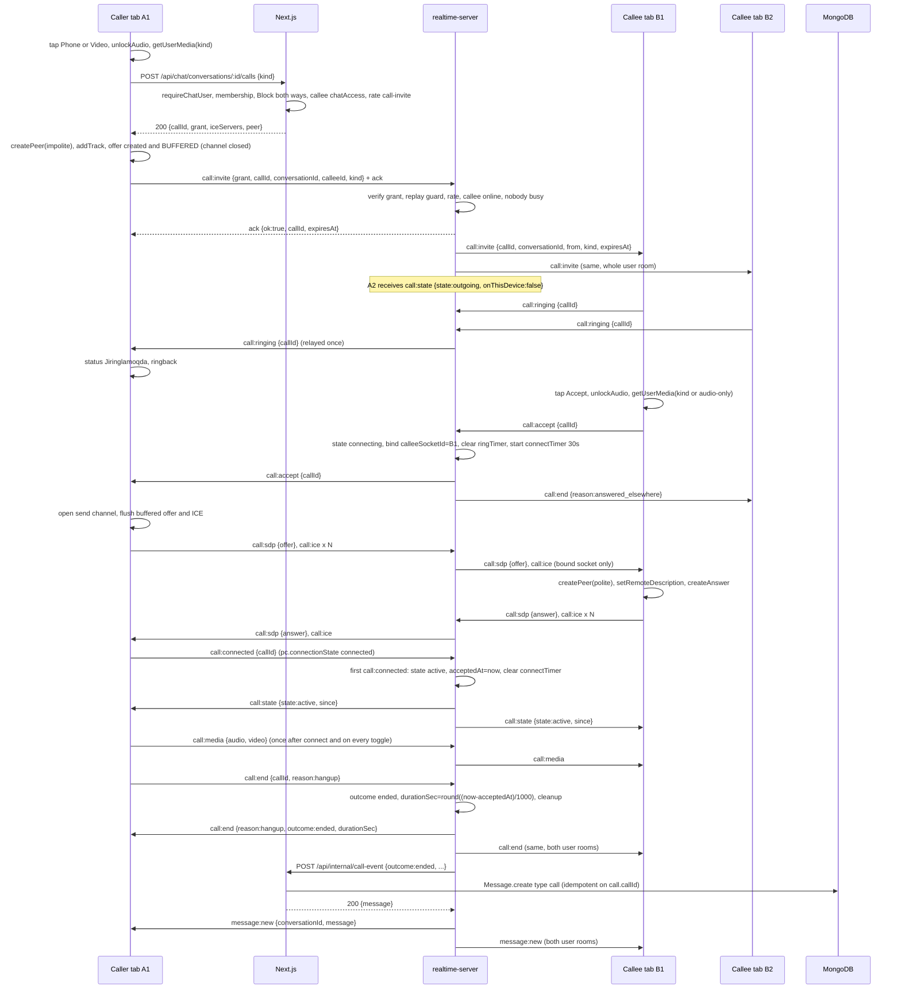
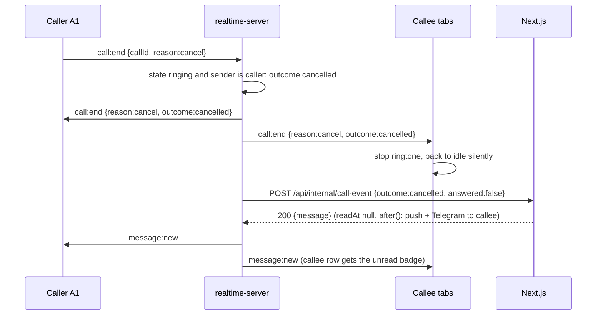
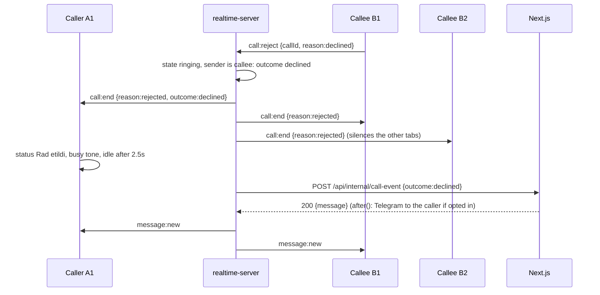
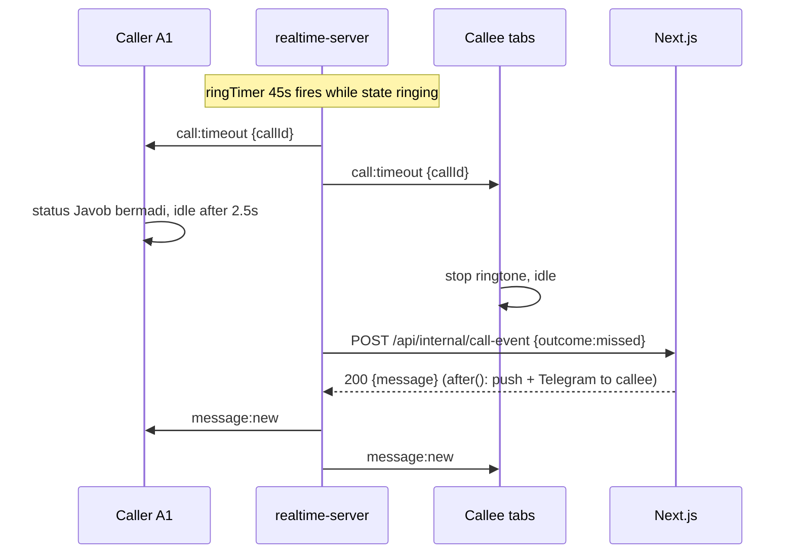
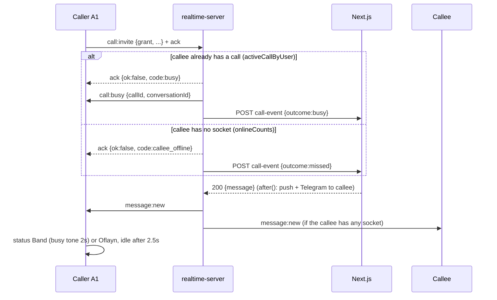
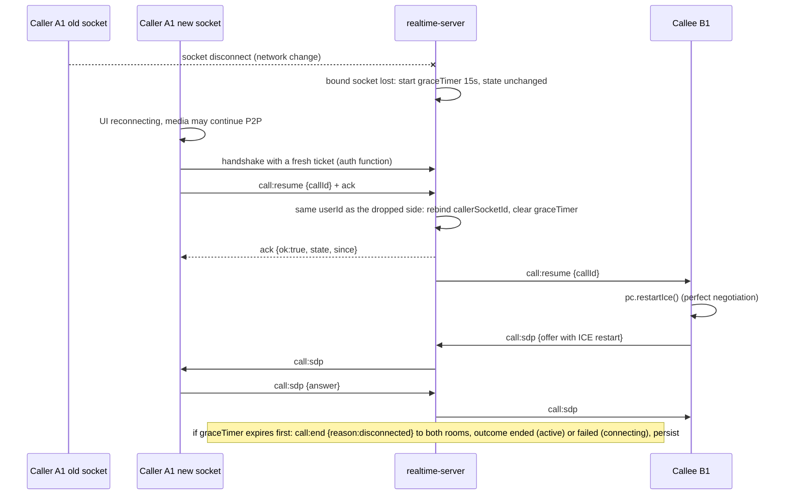
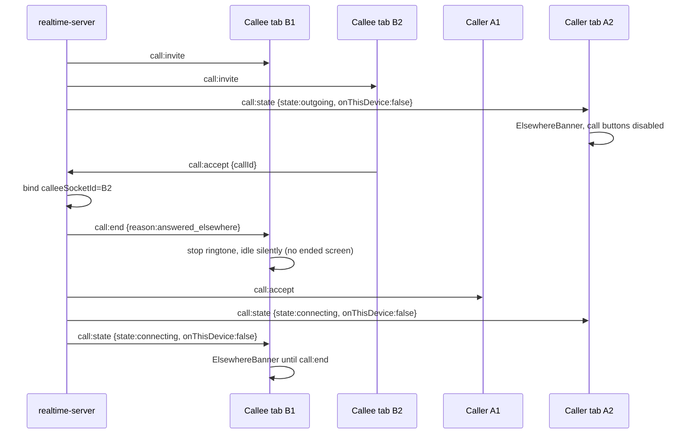

# Vocably chat: 1:1 voice and video calls, technical spec

Status: ready to implement (wave 1 of chat parity). Branch: `feat/chat-parity-calls`.
Companion plan: [`PARITY_PLAN.md`](./PARITY_PLAN.md) (work packages WP1-WP4 and WP9 build what this document specifies).

This document is self-contained: an engineer can build calls from it without the research notes.
Line references (`file.js:123`) point at the tree as of commit `c53732b`; re-check them before editing.

## 0. Scope and fixed decisions

In scope: 1:1 audio and video calls between two chat-enabled users who share a conversation, on every `/app/*` page of the `(main)` route group, with Telegram-like UX (incoming screen, ringtone, in-call controls, minimised strip / PiP card, call bubbles in the thread, missed-call notifications).

Fixed decisions (not open for discussion in this wave):

| Topic | Decision |
|---|---|
| Base design | "UX-first / Telegram parity": perfect negotiation (caller impolite, callee polite), 15 s reconnect grace with `call:resume`, `call:media` mute/camera hints, `answered_elsewhere` multi-tab handling. Where it is silent, the "MVP" design's choices apply (dependency-free `calls.js` state manager, grant replay guard, partial unique index, per-side ICE caps). |
| Concurrency | One active call per user (ringing, connecting and active all count). 1:1 only. Audio and video. |
| Timers | Ring timeout 45 s, connect timeout 30 s, reconnect grace 15 s (server, authoritative). |
| Socket ticket | HS256 JWT `{userId, scope:'realtime'}`, 60 s, signed with `REALTIME_SHARED_SECRET` (done in `c53732b`). |
| Call grant | HS256 JWT, `scope:'call'`, 60 s, signed with `REALTIME_SHARED_SECRET`. |
| Realtime host | `wss://ws.vocably.uz` (Caddy `reverse_proxy vocably-realtime:4001`). |
| TURN | `turn.vocably.uz`, coturn, `use-auth-secret`, `static-auth-secret` from env `TURN_SECRET`, `realm=turn.vocably.uz`, UDP+TCP 3478, relay UDP 49160-49360, `external-ip=185.237.97.126`. Next.js mints time-limited credentials (`username = "${expiresUnix}:${userId}"`, `credential = base64(HMAC-SHA1(TURN_SECRET, username))`) in `GET /api/chat/ice-servers` and in the grant response. |
| Client topology | Socket moves from `ChatProvider` (route-local to `/app/friends`) into `RealtimeProvider` in `src/app/app/(main)/layout.jsx`; `CallProvider` + `<CallOverlay/>` sit beside it; `ChatContext` consumes `useRealtime()`. Ticket fetched per connection attempt (`auth: (cb) => ...`), manual reconnect backoff after an `unauthorized` rejection. |
| History | New `Message.type = 'call'` with a `call` subdocument, persisted by the realtime server via `POST /api/internal/call-event` (idempotent on `call.callId`, partial unique index), then pushed as `message:new` to BOTH participants by the realtime server. |
| Notifications | Missed and declined calls notify via web push and Telegram with the same opt-in/mute rules as messages (who is notified: 7.4). Deliveries in API routes run inside Next's `after()`. |

Out of scope (wave 2 backlog): group calls, screen share, ringing a closed tab through push, TURN over TLS/443, call recording, a ru locale launch (ru strings are written now, see 11).

## 1. Architecture

### 1.1 Components

| Component | Location | Responsibility |
|---|---|---|
| `RealtimeProvider` (new) | `src/context/RealtimeContext.jsx`, mounted in `src/app/app/(main)/layout.jsx` | Owns the single socket for the `(main)` zone: per-attempt ticket fetch, manual reconnect backoff, `connected`, `livePresence`, `queryPresence`, `emit`, `on(event, handler) -> off`, app-wide unread total and toast (PARITY_PLAN WP1). Connects only when `useApp().chatAccess && chatUserId`. |
| `CallProvider` (new) | `src/context/CallContext.jsx`, inside `RealtimeProvider` | Call reducer (`src/lib/call/callMachine.js`), `RTCPeerConnection` wrapper (`src/lib/call/peer.js`), local/remote streams, local safety timers, sounds, vibration, wake lock, Media Session, `beforeunload`, `?call=` deep link. Exposes `useCall()`. |
| `CallOverlay` (new) | `src/components/call/CallOverlay.jsx`, sibling of `<AppShell>` | Renders `IncomingCallScreen`, `InCallScreen`, `MinimizedCall`, `ElsewhereBanner`, the always-mounted remote `<audio>`. `z-[70]` (above MediaViewer `z-[60]`). |
| `ChatProvider` (existing) | unchanged mount (`DoStlarPanel.jsx:143-147`) | Loses its socket effect (`ChatContext.jsx:1322-1473`); subscribes through `useRealtime().on`. Keeps exporting `socketConnected`/`livePresence` (re-exported) so consumers do not change. |
| realtime-server | `realtime-server/` on VPS 185.237.97.126 | Presence + message fan-out (as today) + call signaling + in-memory call state (`calls.js`) + persistence callback to Next + generic `emit-event`. Single replica. |
| Next.js API | `src/app/api/chat/conversations/[id]/calls/route.js`, `src/app/api/chat/ice-servers/route.js`, `src/app/api/internal/call-event/route.js` | Authorisation and grant minting, TURN credential minting, idempotent persistence + call notifications. |
| coturn | VPS, `network_mode: host`, `turn.vocably.uz` | STUN + TURN relay (the only component with public ports besides Caddy). |
| MongoDB | `messages` collection | `type:'call'` rows; the message IS the call record (no Call collection). |

Exam pages (`src/app/app/(exam)`) are outside `(main)` and therefore have no socket: a user in an exam is "offline" for calls (caller sees "Oflayn", callee gets a missed-call row and notification). Intentional.

### 1.2 Trust boundaries

- The realtime server has no database and never sees the session JWT. **Nothing rings unless Next.js signed a grant.** Next checks membership, Block (both directions), callee `chatAccess && !chatBanned`, and rate limits, then signs the grant. The realtime server verifies the signature and binds the grant claims to the socket (`callerId === socket.userId`) and to the payload.
- Display data on the callee's incoming screen (`from.username/name/photoId`) comes from grant claims, never from the caller's payload.
- `POST /api/internal/call-event` re-checks that the conversation exists with exactly `{callerId, calleeId}` as participants before writing (defence in depth against a leaked sidecar secret).
- SDP/ICE/media hints are relayed only between the two bound socket ids, never to rooms.

### 1.3 Deployment topology

```
Browser ──https──► Vercel (Next.js) ──https POST /internal/*──► ws.vocably.uz (Caddy) ─► vocably-realtime:4001
   ├────wss──────► ws.vocably.uz (Caddy reverse_proxy, WS upgrade automatic) ───────────┘        │
   │                                                       Vercel ◄─ https POST /api/internal/call-event
   └──UDP/TCP 3478, UDP 49160-49360──► turn.vocably.uz (coturn, host network, 185.237.97.126)
```

Env (Next.js, Vercel): `REALTIME_SHARED_SECRET`, `REALTIME_INTERNAL_URL=https://ws.vocably.uz`, `NEXT_PUBLIC_REALTIME_URL=https://ws.vocably.uz`, `TURN_SECRET`, `TURN_URLS`, `STUN_URLS`, `TURN_TTL_SEC=3600`. `NEXT_PUBLIC_REALTIME_URL` and the CSP `connect-src` (`next.config.mjs:19-35`) are baked at build time, so the hostname change requires a Vercel redeploy. Vercel env is added through the dashboard (the CLI classifier blocks `vercel env add`).

Env (realtime-server `.env`, chmod 600): `PORT=4001`, `REALTIME_SHARED_SECRET`, `NEXTJS_INTERNAL_URL=https://vocably.uz`, `REALTIME_ALLOWED_ORIGINS=https://vocably.uz,https://www.vocably.uz`, `TURN_SECRET` (read only by the coturn service via compose interpolation), `CALL_RING_TIMEOUT_MS=45000`, `CALL_CONNECT_TIMEOUT_MS=30000`, `CALL_GRACE_MS=15000`. `JWT_SECRET` is no longer used by the sidecar: remove it from compose and `.env.example`.

## 2. Sequence diagrams

Participants: `A1` caller tab (`A2` another caller tab), `N` Next.js, `R` realtime server, `B1`/`B2` callee tabs, `DB` MongoDB.

### 2.1 Invite, ringing, accept, connected, end (happy path)



### 2.2 Cancel (caller hangs up while ringing)



A caller socket disconnect while ringing follows the same flow with `reason:'disconnected'`.

### 2.3 Reject (callee declines)



### 2.4 Ring timeout (no answer)



Clients also run a local 50 s ring watchdog (server timers die with the process).

### 2.5 Busy and offline (rejected at invite time)



`already_in_call` (the caller is in a call), `self_call`, `bad_grant` and `rate_limited` are acked the same way but persist nothing.

### 2.6 Reconnect (socket drop during connecting or active)



If the realtime process restarted, `call:resume` acks `{ok:false, code:'not_in_call'}` and the client ends locally with `call.endedLost`; nothing is persisted (logged).

### 2.7 Answered elsewhere (multi-tab)



A tab that connects while its user has an active call immediately receives `call:state {onThisDevice:false}`.

## 3. Signaling events

Conventions: `c->s` client to server, `s->c` server to client. `callId` is a UUID v4 (`UUID_RE = /^[0-9a-f]{8}-[0-9a-f]{4}-4[0-9a-f]{3}-[89ab][0-9a-f]{3}-[0-9a-f]{12}$/i`); user/conversation ids are 24-hex (`OBJECT_ID_RE`). Every `c->s` handler first checks that the payload is a plain object and `UUID_RE.test(callId)`; malformed input -> `call:error {code:'bad_payload'}` to the emitter only. "Bound" means `socket.id` equals `call.callerSocketId` or `call.calleeSocketId`. Unknown callId -> `call:error {callId, code:'not_in_call'}`.

### 3.1 Client to server

| Event | Payload | Who may send | Validation | Server transition / effect | Ack |
|---|---|---|---|---|---|
| `call:invite` | `{grant, callId, conversationId, calleeId, kind}` | any authenticated socket | `jwt.verify(grant, REALTIME_SHARED_SECRET, {algorithms:['HS256']})`; `scope==='call'`; `grant.callerId===socket.userId`; `grant.callId/conversationId/calleeId/kind` equal the payload; callId neither in `calls` nor in `recentCallIds` (120 s); `callerId!==calleeId`; caller not in `activeCallByUser`; invite bucket <= 5 per 30 s per user | none -> `ringing`: create Call, `activeCallByUser.set(caller)` and `.set(callee)`, `recentCallIds.set(callId)`, start `ringTimer` (45 s); emit `call:invite` to `user:<calleeId>`; emit `call:state {outgoing, onThisDevice:false}` to `user:<callerId>` except this socket | `{ok:true, callId, expiresAt}` or `{ok:false, code}`: `bad_grant`, `self_call`, `already_in_call`, `rate_limited`, `busy` (also emits `call:busy`, persists `busy`), `callee_offline` (persists `missed`) |
| `call:ringing` | `{callId}` | any socket of `calleeId` | `state==='ringing'` | first one relayed as `call:ringing` to `callerSocketId` (`ringingRelayed=true`); later ones ignored | none |
| `call:accept` | `{callId}` | any socket of `calleeId` | `state==='ringing'`, else `call:error {code:'not_ringing'}` | `ringing -> connecting`: clear `ringTimer`, `calleeSocketId=socket.id`, `answered=true`, start `connectTimer` (30 s); emit `call:accept` to `callerSocketId`; `call:end {reason:'answered_elsewhere'}` to `user:<calleeId>` except this socket; `call:state {connecting, onThisDevice:false}` to all non-bound sockets of both users | none |
| `call:reject` | `{callId, reason?:'declined'\|'busy'}` | any socket of `calleeId` | `state==='ringing'` | terminal: outcome `declined` (default) or `busy` (automatic reject from a non-idle client); `call:end {reason:'rejected'\|'busy'}` to both rooms; persist | none |
| `call:sdp` | `{callId, description:{type:'offer'\|'answer', sdp:string}}` | bound sockets only | `state in {connecting, active}`; `description.type` in enum; `sdp.length <= 65536` | relay verbatim to the other bound socket as `call:sdp {callId, description, from}` | none |
| `call:ice` | `{callId, candidate: RTCIceCandidateInit\|null}` | bound sockets only | as `call:sdp`; `JSON.stringify(candidate).length <= 2048`; <= 300 per side per call (excess dropped; the first overflow emits `call:error {code:'ice_limit'}`) | relay to the other bound socket as `call:ice {callId, candidate, from}` | none |
| `call:media` | `{callId, audio:boolean, video:boolean}` | bound sockets only | both booleans; `state in {connecting, active}`; <= 20 per 10 s per side | relay as `call:media {callId, audio, video, from}` | none |
| `call:connected` | `{callId}` | bound sockets only | call exists | first one while `connecting`: `-> active`, `acceptedAt=now`, clear `connectTimer`; emit `call:state {active, since:acceptedAt, onThisDevice:true}` to the two bound sockets and `{..., onThisDevice:false}` to the other sockets of both users. Later ones (after an ICE restart): no-op | none |
| `call:end` | `{callId, reason?:'hangup'\|'cancel'\|'media_error'\|'failed'}` | any socket of `callerId` or `calleeId` | call exists | terminal; outcome per table 4.3 | none |
| `call:resume` | `{callId}` | a socket of the user whose bound socket dropped | `graceTimer` running for that side and `socket.userId` matches that side | rebind that side's socket id, clear `graceTimer`; emit `call:resume {callId}` to the other bound socket | `{ok:true, state, since}` or `{ok:false, code:'not_in_call'}` |

### 3.2 Server to client

| Event | Payload | Recipients | Client effect (CallProvider) |
|---|---|---|---|
| `call:invite` | `{callId, conversationId, kind, from:{userId, username, name, photoId}, expiresAt}` | all sockets of the callee | `idle -> incoming`: ringtone + vibration loop, emit `call:ringing`, prefetch `GET /api/chat/ice-servers`. Not idle: emit `call:reject {callId, reason:'busy'}` silently. |
| `call:ringing` | `{callId}` | `callerSocketId` | `outgoing(ringing:false) -> outgoing(ringing:true)`, ringback starts. |
| `call:accept` | `{callId}` | `callerSocketId` | `outgoing -> connecting`, stop ringback, `peer.open()` flushes the buffered offer + ICE. |
| `call:sdp` / `call:ice` | `{callId, description\|candidate, from}` | the other bound socket | fed into `peer.js` (perfect negotiation). |
| `call:media` | `{callId, audio, video, from}` | the other bound socket | sets `remoteMic` / `remoteCamera` (chips, avatar fallback). |
| `call:state` | `{callId, conversationId, kind, peerId, state:'outgoing'\|'incoming'\|'connecting'\|'active', onThisDevice, since?}` | see 3.1; also every newly connected socket of a user with an active call | `onThisDevice:false` while local state is idle -> `elsewhere`; `state:'active', onThisDevice:true` -> `active` with `since` as the timer base. |
| `call:resume` | `{callId}` | the non-dropped bound socket | `peer.restartIce()`. |
| `call:busy` | `{callId, conversationId}` | the inviting socket (redundant with the ack) | `-> ended('busy')` if still inviting. |
| `call:timeout` | `{callId}` | both user rooms | caller `-> ended('timeout')`; callee `incoming -> idle`. |
| `call:end` | `{callId, reason, outcome, durationSec}`; reason in `hangup`, `cancel`, `rejected`, `busy`, `answered_elsewhere`, `disconnected`, `offline`, `media_error`, `failed`, `blocked`, `banned`, `admin`, `server_shutdown` | both user rooms (`answered_elsewhere`: only the callee's non-accepting sockets) | `answered_elsewhere` -> idle silently; on callee tabs that never accepted, `rejected`/`cancel`/`offline`/`busy` -> idle silently; otherwise `-> ended(reason, durationSec)` -> idle after 1.5 s (outcome `ended`) or 2.5 s (others). |
| `call:error` | `{callId?, code}`; code in `bad_grant`, `self_call`, `already_in_call`, `busy`, `callee_offline`, `rate_limited`, `not_ringing`, `not_in_call`, `bad_payload`, `ice_limit` | emitting socket only | concerns the current `callId` and state not idle: `-> ended(code)`; `ice_limit`: log only; otherwise log. |
| `message:new` | `{conversationId, message}` with `message = {id, _id, conversationId, senderId:callerId, type:'call', call:{...}, text:'', media:null, readAt, createdAt, reactions:[]}` | both user rooms, emitted by the realtime server after `call-event` returns 200 | `ChatContext` appends / bumps the list; no toast for `type:'call'`; unread bump only if `senderId !== me && !message.readAt`. |

### 3.3 Existing handshake (changed on the client only)

```js
io(NEXT_PUBLIC_REALTIME_URL, {
  auth: (cb) => fetchTicket().then((token) => cb({ token })).catch(() => cb({ token: '' })),
  transports: ['websocket', 'polling'], reconnection: true, reconnectionAttempts: Infinity,
  reconnectionDelay: 1500, reconnectionDelayMax: 10000, randomizationFactor: 0.5, timeout: 5000,
});
```

socket.io-client v4 calls the `auth` function on every connection attempt, so every automatic reconnect carries a fresh 60 s ticket. A middleware rejection (`connect_error` with `err.message === 'unauthorized'`) is not retried automatically (`socket.active === false`), so `RealtimeProvider` calls `socket.connect()` itself with backoff 2 s, 4 s, 8 s, 16 s, 30 s (cap), reset on `connect`. If the ticket POST answers 401/403 (session expired, chat access revoked) the provider calls `socket.disconnect()` and stops until the next `visibilitychange` to visible or a re-login. The `socket-ticket` rate limit rises from 30 to 60 per minute.

## 4. Server state machine

### 4.1 Data

```js
// realtime-server/calls.js (in memory, single process)
Call = {
  callId, conversationId, callerId, calleeId, kind,           // from the verified grant
  from: { userId, username, name, photoId },                   // grant display claims
  state: 'ringing' | 'connecting' | 'active',                  // terminal states are not stored
  callerSocketId, calleeSocketId,                              // calleeSocketId null until accept
  createdAt, acceptedAt,                                       // ms; acceptedAt = first call:connected (media connected)
  answered: false,                                             // true after call:accept
  ringingRelayed: false,
  ringTimer, connectTimer, graceTimer, graceSide,              // graceSide: 'caller' | 'callee' | null
  disconnectedAt,                                              // ms, set when grace starts
  iceCount: { caller: 0, callee: 0 }, mediaHits: { caller: [], callee: [] },
}
calls: Map<callId, Call>
activeCallByUser: Map<userId, callId>       // both participants from invite until terminal
recentCallIds: Map<callId, expiresAtMs>     // 120 s grant replay guard, pruned on insert
inviteBuckets: Map<userId, number[]>        // timestamps, 5 per 30 s
```

### 4.2 States and timers

```
           call:invite ok
 (none) ───────────────────► ringing ── call:accept ──► connecting ── first call:connected ──► active
                               │ ringTimer 45 s -> missed     │ connectTimer 30 s -> failed       │ call:end -> ended
                               │ caller call:end -> cancelled │ call:end -> see 4.3               │ bound socket lost -> grace 15 s
                               │ call:reject -> declined/busy │ bound socket lost -> grace 15 s   │   resume -> stays active
                               │ caller socket lost -> canc.  │   resume -> stays connecting      │   expiry -> ended (to disconnect)
                               │ callee offline -> missed     │   expiry -> failed                │ forceEnd -> ended
                               │ forceEnd -> cancelled        │ forceEnd -> failed                │
```

| Timer | Started | Cleared | On fire |
|---|---|---|---|
| `ringTimer` (`CALL_RING_TIMEOUT_MS`, 45000) | invite ok | accept, any terminal | emit `call:timeout` to both rooms, finish `missed` |
| `connectTimer` (`CALL_CONNECT_TIMEOUT_MS`, 30000) | accept | first `call:connected`, any terminal | finish `failed`, reason `failed` |
| `graceTimer` (`CALL_GRACE_MS`, 15000) | disconnect of a bound socket while connecting/active | `call:resume` from that side, any terminal | finish `failed` (connecting) or `ended` with `durationSec = round((disconnectedAt - acceptedAt)/1000)` (active), reason `disconnected` |

The connect timer keeps running during a grace period (a call that never connects still fails at 30 s).

### 4.3 Terminal outcome mapping

| Trigger | State | Outcome | Reason in `call:end` |
|---|---|---|---|
| caller `call:end` | ringing | `cancelled` | `cancel` |
| callee `call:end`, or `call:reject {declined}` | ringing | `declined` | `rejected` |
| callee `call:reject {busy}` | ringing | `busy` | `busy` |
| `ringTimer` | ringing | `missed` | (`call:timeout` event instead) |
| caller socket disconnect | ringing | `cancelled` | `disconnected` |
| callee `onlineCounts` reaches 0 | ringing | `missed` | `offline` |
| caller `call:end {hangup\|cancel}` | connecting | `cancelled` | `cancel` |
| callee `call:end {hangup}` | connecting | `declined` | `rejected` |
| any `call:end {media_error\|failed}` | connecting | `failed` | as sent |
| `connectTimer` | connecting | `failed` | `failed` |
| grace expiry | connecting | `failed` | `disconnected` |
| any `call:end` | active | `ended`, `durationSec` from `acceptedAt` | as sent (`hangup` default) |
| grace expiry | active | `ended`, duration to `disconnectedAt` | `disconnected` |
| `forceEnd` (block / ban / admin) | ringing / connecting / active | `cancelled` / `failed` / `ended` | `blocked` / `banned` / `admin` |
| SIGTERM (`shutdown`) | any | as forceEnd | `server_shutdown` |
| invite while the callee is in a call | (none) | `busy` | (ack only) |
| invite while the callee is offline | (none) | `missed` | (ack only) |

`finish(call, outcome, reason)` is idempotent (a second call is a no-op) and always: clears all timers; deletes `calls[callId]` and both `activeCallByUser` entries (only those still pointing at this callId); emits `call:end {callId, reason, outcome, durationSec}` to both user rooms (or `call:timeout` for the ring timeout); then calls `persist()` (5.3) without awaiting it inside the socket handler.

### 4.4 Disconnect and connect rules

`onDisconnect(socket, { userNowOffline })` runs BEFORE the `onlineCounts` bookkeeping in `server.js`; `userNowOffline` is computed from the count:

- ringing and the socket is `callerSocketId` -> finish `cancelled` / `disconnected`.
- ringing and the socket belongs to the callee: if `userNowOffline` finish `missed` / `offline`, otherwise no-op.
- connecting/active and the socket is bound -> start `graceTimer`, set `graceSide` and `disconnectedAt`; state unchanged. If the other side's bound socket is lost while a grace timer runs: finish immediately (`ended` / `failed`, reason `disconnected`).
- any other socket: no-op.

`onConnect(socket)`: if `activeCallByUser.has(socket.userId)` emit `call:state {..., onThisDevice:false}` to that socket.

## 5. realtime-server module layout

```
realtime-server/
  index.js             // bootstrap: dotenv, createRealtimeServer(), listen(PORT), SIGTERM/SIGINT -> shutdown()
  server.js            // createRealtimeServer({ env, fetchImpl, now }) -> { app, server, io, calls, listen, close, shutdown }
  calls.js             // createCallManager(deps): the state machine above; no socket.io/express imports
  persist.js           // createPersister({ url, secret, fetchImpl, timeoutMs:8000, retryDelaysMs:[1000,3000,9000], log })
  package.json         // dependencies unchanged (express, socket.io, jsonwebtoken, dotenv)
  package-lock.json    // NEW: generated once with `npm install`; Dockerfile switches to `npm ci --omit=dev`
  Dockerfile           // COPY package.json package-lock.json ./ ; RUN npm ci --omit=dev ; COPY *.js ./
  docker-compose.yml   // realtime + coturn (8.3)
  coturn/turnserver.conf
  Caddyfile.snippet    // ws.vocably.uz block + reload command
  .env.example         // updated per 1.3
```

Delete `nginx-realtime.conf` and `nginx-media.conf` (they describe the dead AWS host).

### 5.1 `server.js`

Moves everything `index.js` does today into `createRealtimeServer`, behaviour unchanged, plus:
- `const calls = createCallManager({ io, verifyGrant, persist, isOnline: (id) => onlineCounts.has(id), log: console, limits })`; `verifyGrant = (g) => jwt.verify(g, INTERNAL_SECRET, { algorithms: ['HS256'] })`; limits from `CALL_RING_TIMEOUT_MS`, `CALL_CONNECT_TIMEOUT_MS`, `CALL_GRACE_MS`.
- Inside `io.on('connection')` after the `typing` handler: `calls.onConnect(socket)`, then `socket.on('call:invite', (p, cb) => calls.invite(socket, p, typeof cb === 'function' ? cb : () => {}))` and one line each for `call:ringing`, `call:accept`, `call:reject`, `call:sdp` / `call:ice` / `call:media` (`calls.relay(socket, event, p)`), `call:connected`, `call:end`, `call:resume` (with ack).
- `disconnect`: compute `n = count - 1`, call `calls.onDisconnect(socket, { userNowOffline: n <= 0 })`, then the existing bookkeeping.
- Production guard: `NODE_ENV==='production'` and empty `REALTIME_ALLOWED_ORIGINS` -> throw at startup (today it silently falls back to CORS `*`).
- `express.json({ limit: '100kb' })`.
- New internal HTTP, all behind `requireInternalSecret`:
  - `POST /internal/emit-event {userIds: string[1..10], event, payload}` -> `io.to(userIds.map((id) => 'user:' + id)).emit(event, payload)`; `event` must be in `EMIT_EVENT_ALLOWLIST = ['message:new', 'message:reacted', 'draft:update', 'conversation:read']`, ids 24-hex, else 400. Generic both-sides/self primitive used by PARITY_PLAN WP3/WP5/WP6/WP7.
  - `POST /internal/call-end {userId, peerId?, reason:'blocked'|'banned'|'admin'}` -> `calls.forceEnd(...)` -> `{ok:true, ended:boolean}`. With `peerId`, only a call between `userId` and `peerId` is ended.
  - `GET /internal/calls/:userId` -> `{inCall:boolean, callId?, state?}`.
  - `GET /health` -> `{ok:true, calls: calls.size(), online: onlineCounts.size}`.
- `shutdown(reason)`: `await calls.shutdown('server_shutdown')` (finishes every call, waits for pending persists up to 5 s), then `io.close()` and `server.close()`.

### 5.2 `calls.js` API

```js
// CommonJS, dependency-free: every side effect goes through deps so vitest drives it with a fake io and fake timers.
function createCallManager({
  io,               // io.to(target | target[]).except?(socketId).emit(event, payload); target = 'user:<id>' or a socket id
  verifyGrant,      // (grant: string) => claims, throws on invalid
  persist,          // (body: CallEventBody) => Promise<{ message } | null>
  isOnline,         // (userId) => boolean
  now = Date.now,
  setTimer = setTimeout, clearTimer = clearTimeout,
  log = console,
  limits = { RING_MS: 45000, CONNECT_MS: 30000, GRACE_MS: 15000, SDP_MAX: 65536, ICE_MAX: 2048, ICE_PER_SIDE: 300,
             INVITES_PER_WINDOW: 5, INVITE_WINDOW_MS: 30000, REPLAY_MS: 120000, MEDIA_PER_WINDOW: 20, MEDIA_WINDOW_MS: 10000 },
}) {
  return {
    invite(socket, payload, ack), ringing(socket, payload), accept(socket, payload), reject(socket, payload),
    relay(socket, event /* 'call:sdp' | 'call:ice' | 'call:media' */, payload),
    connected(socket, payload), end(socket, payload), resume(socket, payload, ack),
    onConnect(socket), onDisconnect(socket, { userNowOffline }),
    forceEnd({ userId, peerId, reason }) /* -> boolean */, getUserCall(userId) /* -> { callId, state } | null */,
    shutdown(reason) /* -> Promise<void> */, size() /* -> number */,
  };
}
module.exports = { createCallManager, UUID_RE };
```

`socket` is anything with `{ id, userId, emit(event, payload) }`. "Both rooms" emits use `io.to(['user:' + callerId, 'user:' + calleeId])`. After `persist()` resolves `{message}`, `calls.js` emits `message:new {conversationId, message}` to both rooms. Comments in Uzbek like the rest of the codebase.

### 5.3 Persistence (`persist.js`)

`persist(body)` POSTs `${NEXTJS_INTERNAL_URL}/api/internal/call-event` with `X-Internal-Secret`, an 8 s `AbortController` per attempt and retries after 1 s / 3 s / 9 s on network errors or 5xx (never on 4xx). 200 -> resolves `{message}`. Final failure -> `console.error('[realtime] call-event saqlanmadi', JSON.stringify(body))` and resolves `null`. `NEXTJS_INTERNAL_URL` unset -> one startup warning ("calls: history disabled") and every call resolves `null`.

`CallEventBody = { callId, conversationId, callerId, calleeId, kind, outcome, durationSec: number|null, startedAt: ISO, acceptedAt: ISO|null, endedAt: ISO, answered: boolean }`.

## 6. Next.js API contracts

Conventions: `export async function POST(req, props)`, `const params = await props.params`, body via `await req.json()` (sanitised by `safeRequest`), `try { ... } catch (err) { return serverError(err, 'chat/calls POST') }`, Uzbek error strings (translated client-side via `ts()`; each one is added to `serverTextEn.js`). Error JSON carries a stable `code` next to `error`.

### 6.1 `POST /api/chat/conversations/[id]/calls` (call grant)

File `src/app/api/chat/conversations/[id]/calls/route.js`. Request `{ "kind": "audio" | "video" }`.

1. `requireChatUser(req)` (401/403/404 as today).
2. `kind` not in enum -> 400 `{error:"Noto'g'ri qo'ng'iroq turi", code:'bad_kind'}`.
3. `REALTIME_SHARED_SECRET` or `NEXT_PUBLIC_REALTIME_URL` unset -> 503 `{error:'Server sozlanmagan', code:'not_configured'}`.
4. `connectToDatabase()`; `loadConversationForUser(params.id, user._id)` (extract the helper at `messages/route.js:23-28` into `src/lib/chat/conversationAccess.js`, import it from both) -> 404 `{error:'Suhbat topilmadi', code:'not_found'}`.
5. `otherId` = the other participant; Block either direction (copy `messages/route.js:126-132`) -> 403 `{error:"Qo'ng'iroq qilib bo'lmadi", code:'blocked'}`.
6. Callee `User.findById(otherId).select('username name chatAccess chatBanned')`: missing, `!chatAccess` or `chatBanned` -> 403 `{error:"Qo'ng'iroq qilib bo'lmadi", code:'callee_unavailable'}`.
7. `checkRateLimit(user._id, 'call-invite', 10)` false -> 429 `{error:"Juda ko'p qo'ng'iroq. Biroz kuting.", code:'rate_limited'}`.
8. `callId = crypto.randomUUID()`; the caller's `photoId` as the callee may see it (same rule as `GET /api/chat/conversations`, `conversations/route.js:46ff`; extract `visiblePhotoId(owner, viewerId)` to `src/lib/chat/photoVisibility.js` if no helper exists).
9. `grant = jwt.sign({ scope:'call', callId, conversationId, callerId, calleeId, kind, from:{ userId:callerId, username, name, photoId } }, REALTIME_SHARED_SECRET, { algorithm:'HS256', expiresIn:'60s' })`.
10. `ice = buildIceServers(String(user._id))` (8.1).

Response 200, `Cache-Control: no-store`:

```json
{
  "callId": "8f6d2c1e-3b4a-4c5d-9e8f-0a1b2c3d4e5f",
  "grant": "<jwt>",
  "expiresAt": "2026-11-06T10:01:00.000Z",
  "iceServers": [
    { "urls": ["stun:turn.vocably.uz:3478"] },
    { "urls": ["turn:turn.vocably.uz:3478?transport=udp", "turn:turn.vocably.uz:3478?transport=tcp"],
      "username": "1762430400:64e2e0000000000000000001", "credential": "<base64>" }
  ],
  "iceTtlSec": 3600,
  "turn": true,
  "peer": { "id": "64e2e0000000000000000003", "username": "e2efriend", "name": "Friend", "nickname": null, "photoId": null }
}
```

`peer.nickname` = the caller's nickname for the callee (`convo.nicknames`).

### 6.2 `GET /api/chat/ice-servers`

File `src/app/api/chat/ice-servers/route.js`. `requireChatUser`; `checkRateLimit(user._id, 'ice-servers', 20)` false -> 429 `{error:"Juda ko'p so'rov. Biroz kuting.", code:'rate_limited'}`; 200 `{ iceServers, ttlSec, turn }` with `Cache-Control: no-store`. Called by the callee on `call:invite` (cached 50 min in `CallProvider`), never on a timer (every `/api/chat/*` call bumps `lastActiveAt`).

### 6.3 `POST /api/internal/call-event`

File `src/app/api/internal/call-event/route.js`. Guard copied from `src/app/api/internal/presence-online/route.js:16-21` (`safeEqual(req.headers.get('x-internal-secret'), process.env.REALTIME_SHARED_SECRET)`) -> 401 `{error:'unauthorized'}`.

Request: `CallEventBody` (5.3). Validation -> 400 `{error:'bad payload', field}`: `callId` UUID; ids 24-hex; `kind`, `outcome` enums; ISO dates parse; `durationSec` is a non-negative integer when `outcome==='ended'`, else null; `acceptedAt` null unless `outcome==='ended'`; `endedAt >= startedAt`; `answered` boolean.

1. `Conversation.findOne({ _id: conversationId, participantIds: { $all: [callerId, calleeId] } })` -> 404 `{error:'not found'}`.
2. Idempotency: `Message.findOne({ 'call.callId': callId })` -> 200 `{ message: normalise(existing), created:false }`.
3. `Message.create({ conversationId, senderId: callerId, type:'call', text:'', media:null, call:{ callId, kind, outcome, durationSec, startedAt, acceptedAt, endedAt }, readAt, createdAt: endedAt })`, where `readAt = (['ended','declined','failed'].includes(outcome) || answered) ? endedAt : null`. On E11000 re-read and answer as in step 2.
4. Conversation update as in `messages/route.js:246-259`: `lastMessageAt = endedAt`, `lastMessagePreview = previewForMessage(message)`, pull the callee from `archivedBy`, pull both from `hiddenFor`.
5. 200 `{ message: normalise(doc), created:true }`; `normalise` adds `id` next to `_id` (socket payload convention, `messages/route.js:268-281`) and `reactions: []`.
6. Only when `created`: `after(async () => { await Promise.allSettled(callNotifications(...)) })` (7.4). The route never calls `pushNewMessage`; the realtime server emits `message:new` itself.

### 6.4 Force-ending calls from Next.js

`src/lib/realtime.js` gains `forceEndCall(userId, reason, peerId)` -> `postInternal('/internal/call-end', { userId:String(userId), peerId: peerId && String(peerId), reason })` (3 s, silent no-op when env is unset). Callers, inside `after()`:
- `POST /api/chat/block` after the Block upsert: `forceEndCall(user._id, 'blocked', targetId)`.
- `src/app/api/admin/chat/users/[id]/route.js` when `chatBanned` becomes true: `forceEndCall(targetId, 'banned')`.

### 6.5 Changes in existing routes

- `src/app/api/chat/conversations/[id]/messages/route.js`: before the type switch `if (body.type === 'call') return 400 {error:"Noto'g'ri xabar turi"}` (only call-event creates calls); `resolveForward` rejects `original.type === 'call'` with `{error:"Bu xabarni yuborib bo'lmaydi"}`; the replyTo snapshot ignores call targets; preview via `previewForMessage`.
- `[messageId]/route.js`: `recomputeLastMessageIfNeeded` uses `previewForMessage`. PATCH already rejects non-text. DELETE unchanged (caller = sender may delete for everyone; callee may delete for themselves).
- `[messageId]/pin/route.js`: `type === 'call'` -> 400 `{error:"Qo'ng'iroqni qadab bo'lmaydi"}`.
- `src/lib/auth.js:66-70`: `if (decoded.scope === 'realtime') return null;` becomes `if (decoded.scope) return null;` (no scoped token ever acts as a session).
- `src/components/admin/ConversationViewer.jsx:64-67, 464-465`: call rows render `📞 {kind} · {outcome} · {formatCallDuration(durationSec)}`.

## 7. Data model

### 7.1 `src/lib/models.js`

```js
// Qo'ng'iroq yozuvi — xabarning o'zi qo'ng'iroq tarixi (alohida Call kolleksiyasi yo'q).
const CallInfoSchema = new mongoose.Schema({
  callId: { type: String, required: true },                                          // UUID, /calls route
  kind: { type: String, enum: ['audio', 'video'], required: true },
  outcome: { type: String, enum: ['ended', 'missed', 'declined', 'busy', 'cancelled', 'failed'], required: true },
  durationSec: { type: Number, default: null },                                      // faqat outcome === 'ended'
  startedAt: { type: Date, required: true },                                         // invite vaqti
  acceptedAt: { type: Date, default: null },                                         // media ulangan vaqt (birinchi call:connected)
  endedAt: { type: Date, required: true },
}, { _id: false });

// MessageSchema, line 553:
type: { type: String, enum: ['text', 'image', 'video', 'voice', 'file', 'sticker', 'call'], required: true },
// after forwardedFrom (561-564):
call: { type: CallInfoSchema, default: null },
// next to the indexes (593-599):
MessageSchema.index({ 'call.callId': 1 }, { unique: true, partialFilterExpression: { 'call.callId': { $type: 'string' } } });

// ConversationSchema, next to tgMessageNotifiedAt (469):
tgCallNotifiedAt: { type: Map, of: Date, default: {} },
```

Partial (not `sparse`) so the non-call messages with `call: null` are never indexed.

Row semantics: `senderId = callerId` (so `isMine` in `MessageBubble` gives the direction), `text:''`, `media:null`, `createdAt = endedAt`. `readAt = null` for `missed|busy|cancelled` when the callee never answered, so the existing unread aggregate (`conversations/route.js:70-83`) badges missed calls for the callee; it clears through the normal `markConversationRead`. Call rows cannot be forwarded, pinned, edited, replied to or reacted to. `docs/DB_SCHEMA.md` (enum line ~150) and `docs/API_INVENTORY.md` document the type and routes.

### 7.2 `src/lib/chatConstants.js` (pure, no imports)

```js
export const CALL_OUTCOMES = ['ended', 'missed', 'declined', 'busy', 'cancelled', 'failed'];
PREVIEW_BY_TYPE.call = "📞 Qo'ng'iroq";
REPLY_TYPE_LABEL.call = "📞 Qo'ng'iroq";            // defensive; replies to calls are rejected
export function formatCallDuration(sec) {}          // null -> '', 0 -> '0:00', 59 -> '0:59', 133 -> '2:13', 3661 -> '61:01'
export function callPreview({ outcome, durationSec }) {}
// ended -> "📞 Qo'ng'iroq (2:13)"; missed | busy | cancelled -> "📞 Javobsiz qo'ng'iroq";
// declined -> "📞 Rad etilgan qo'ng'iroq"; failed -> "📞 Amalga oshmagan qo'ng'iroq"
export function previewForMessage(m) {}             // text/caption -> slice(0, 80); 'call' -> callPreview(m.call); else PREVIEW_BY_TYPE[m.type] || ''
```

`previewForMessage` replaces the ad hoc preview code in messages POST, `recomputeLastMessageIfNeeded`, call-event, and `ChatContext` (`previewFor` ~395, the toast ~1393/1397).

`src/lib/i18n/serverTextEn.js` exact entries: `"📞 Qo'ng'iroq"` -> `"📞 Call"`; `"📞 Javobsiz qo'ng'iroq"` -> `"📞 Missed call"`; `"📞 Rad etilgan qo'ng'iroq"` -> `"📞 Declined call"`; `"📞 Amalga oshmagan qo'ng'iroq"` -> `"📞 Failed call"`; `"Qo'ng'iroq qilib bo'lmadi"` -> `"Could not place the call"`; `"Noto'g'ri qo'ng'iroq turi"` -> `"Invalid call type"`; `"Juda ko'p qo'ng'iroq. Biroz kuting."` -> `"Too many calls. Please wait a moment."`; `"Juda ko'p so'rov. Biroz kuting."` -> `"Too many requests. Please wait a moment."`; `"Bu xabarni yuborib bo'lmaydi"` -> `"This message cannot be forwarded"`; `"Qo'ng'iroqni qadab bo'lmaydi"` -> `"A call cannot be pinned"`. Pattern: `{ uz: "📞 Qo'ng'iroq ({d})", tr: "📞 Call ({d})" }`. `serverText.test.ts` enforces coverage.

### 7.3 Socket payload of a call row

`{ id, _id, conversationId, senderId, type:'call', text:'', media:null, stickerId:null, replyTo:null, albumId:null, forwardedFrom:null, call:{ callId, kind, outcome, durationSec, startedAt, acceptedAt, endedAt }, reactions:[], readAt, createdAt }`.

### 7.4 Call notifications (inside `after()` in call-event)

Rule: the participant who did not act on the call is notified, with the same opt-in and mute rules as a message.

| Outcome | Notified | Web push | Telegram |
|---|---|---|---|
| `missed`, `busy`, `cancelled` with `answered:false` | callee | unless `isConversationMuted(convo, calleeId)`: `{title: callerLabel, body:"📞 Javobsiz qo'ng'iroq", url:"/app/friends/<callerUsername>?call=<kind>", tag:"call-<callId>", actions:[{action:'callback', title:"Qayta qo'ng'iroq qilish"}]}` | `notifyCallViaTelegram` to the callee: `📞 <label> sizga qo'ng'iroq qildi (javobsiz).` with inline button `Qayta qo'ng'iroq qilish` -> `${APP_URL}/app/friends/<callerUsername>?call=<kind>` |
| `declined` | caller | no (the caller watched it happen) | `notifyCallViaTelegram` to the caller: `📞 <label> qo'ng'iroqni rad etdi.` with button `Suhbatni ochish` -> `${APP_URL}/app/friends/<calleeUsername>` |
| `ended`, `failed`, or `answered:true` | nobody | no | no |

`callerLabel`/`label` = `@username` (or `name`) of the other party. `src/lib/chatNotify.js` (new): `notifyRecipientViaTelegram` and `escapeHtml` move out of `messages/route.js:331-378` unchanged, plus `notifyCallViaTelegram({ convo, recipientId, text, buttonText, url })` with the same opt-in rules (`isTgMessageNotifyOn`, explicit-on or not muted, admin chat) and its own atomic throttle key `tgCallNotifiedAt.<recipientId>` (60 s), so a missed call right after a text is not swallowed by the 20 s message throttle. Bot texts stay Uzbek and add `(Qo'ng'iroq uchun brauzerda oching.)` because Telegram's in-app WebView has no `getUserMedia`.

`src/lib/webPush.js`: `sendPushToUser(userId, { title, body, url, tag?, renotify?, requireInteraction?, actions? })` passes the extra fields. `public/sw.js`: `push` (104-119) forwards `tag/renotify/requireInteraction/actions` to `showNotification`; `notificationclick` (122-140) opens `data.url` for `event.action === 'callback'` and for a body click.

## 8. TURN

### 8.1 Credential algorithm (`src/lib/turn.js`, pure, unit-tested)

```js
import { createHmac } from 'node:crypto';

// coturn use-auth-secret (TURN REST API): username = "<expiry unix sec>:<userId>", password = base64(HMAC-SHA1(secret, username)).
export function buildTurnCredentials(secret, userId, ttlSec, nowSec) {
  const username = `${nowSec + ttlSec}:${userId}`;
  return { username, credential: createHmac('sha1', secret).update(username).digest('base64') };
}

const splitList = (v) => (v ? v.split(',').map((s) => s.trim()).filter(Boolean) : null);

export function buildIceServers(userId, env = process.env, nowSec = Math.floor(Date.now() / 1000)) {
  const ttlSec = Number(env.TURN_TTL_SEC) || 3600;
  if (!env.TURN_SECRET) {
    warnOnce('[turn] TURN_SECRET sozlanmagan — faqat STUN');
    return { iceServers: [{ urls: ['stun:stun.l.google.com:19302'] }], ttlSec, turn: false };
  }
  const stun = splitList(env.STUN_URLS) || ['stun:turn.vocably.uz:3478'];
  const turnUrls = splitList(env.TURN_URLS) || ['turn:turn.vocably.uz:3478?transport=udp', 'turn:turn.vocably.uz:3478?transport=tcp'];
  return {
    iceServers: [{ urls: stun }, { urls: turnUrls, ...buildTurnCredentials(env.TURN_SECRET, String(userId), ttlSec, nowSec) }],
    ttlSec, turn: true,
  };
}
```

Pinned vector: `buildTurnCredentials('test-secret', '64e2e0000000000000000001', 3600, 1700000000)` -> `{ username: '1700003600:64e2e0000000000000000001', credential: 'zw16hwVv/P3iWBzRlq8yBjG9Brw=' }`.

Client peer config: `new RTCPeerConnection({ iceServers, iceTransportPolicy: process.env.NEXT_PUBLIC_CALL_FORCE_RELAY === '1' ? 'relay' : 'all', bundlePolicy:'max-bundle', rtcpMuxPolicy:'require', iceCandidatePoolSize: 2 })`. `NEXT_PUBLIC_CALL_FORCE_RELAY=1` exists only for TURN verification builds.

### 8.2 `realtime-server/coturn/turnserver.conf`

```
listening-port=3478
listening-ip=0.0.0.0
external-ip=185.237.97.126
realm=turn.vocably.uz
use-auth-secret
# static-auth-secret comes from TURN_SECRET on the command line (coturn does not expand env vars in this file)
min-port=49160
max-port=49360
fingerprint
no-cli
no-tls
no-dtls
no-multicast-peers
no-tcp-relay
stale-nonce=600
user-quota=12
total-quota=1200
max-bps=1500000
log-file=stdout
denied-peer-ip=0.0.0.0-0.255.255.255
denied-peer-ip=10.0.0.0-10.255.255.255
denied-peer-ip=100.64.0.0-100.127.255.255
denied-peer-ip=127.0.0.0-127.255.255.255
denied-peer-ip=169.254.0.0-169.254.255.255
denied-peer-ip=172.16.0.0-172.31.255.255
denied-peer-ip=192.168.0.0-192.168.255.255
```

The `denied-peer-ip` ranges stop the relay from reaching the SocialAuto/Garage containers on the same host.

### 8.3 Compose, Caddy, DNS, firewall

```yaml
# realtime-server/docker-compose.yml
services:
  realtime:
    build: .
    container_name: vocably-realtime
    restart: unless-stopped
    env_file: .env
    expose: ['4001']
    networks: [socialauto_default]
    healthcheck: { test: ['CMD', 'wget', '-qO-', 'http://127.0.0.1:4001/health'], interval: 30s, timeout: 5s, retries: 3 }
    logging: { driver: json-file, options: { max-size: 10m, max-file: '3' } }
  coturn:
    image: coturn/coturn:4.6
    container_name: vocably-coturn
    restart: unless-stopped
    network_mode: host
    volumes: ['./coturn/turnserver.conf:/etc/coturn/turnserver.conf:ro']
    command: ['-c', '/etc/coturn/turnserver.conf', '--static-auth-secret=${TURN_SECRET}']
networks:
  socialauto_default: { external: true }
```

No `ports:` on `realtime` (Caddy reaches it by container name; the old `minio` service is removed). `realtime-server/Caddyfile.snippet`, appended to `/home/socialauto/Caddyfile`, then `docker exec socialauto-caddy-1 caddy reload --config /etc/caddy/Caddyfile`:

```
ws.vocably.uz {
  reverse_proxy vocably-realtime:4001
}
```

DNS (ahost.uz zone editor): A `ws` -> 185.237.97.126, A `turn` -> 185.237.97.126. Firewall: `ufw allow 3478/udp`, `ufw allow 3478/tcp`, `ufw allow 49160:49360/udp`.

Verification: `curl https://ws.vocably.uz/health` -> `{"ok":true,...}`; DevTools shows `wss://ws.vocably.uz/socket.io/?EIO=4&transport=websocket` 101; `GET /api/chat/ice-servers` -> `turn:true`; the Trickle ICE sample page with minted credentials lists `relay` candidates; a cross-network call shows a `relay` or `srflx` pair in `chrome://webrtc-internals`.

## 9. Client modules

```
src/lib/socketClient.js            // connectChatSocket(fetchTicket) (3.3)
src/context/RealtimeContext.jsx    // RealtimeProvider + useRealtime() (PARITY_PLAN WP1)
src/context/CallContext.jsx        // CallProvider + useCall()
src/lib/call/callMachine.js        // pure reducer (9.1)
src/lib/call/peer.js               // RTCPeerConnection wrapper, perfect negotiation (9.2)
src/lib/call/devices.js            // capability checks, getUserMedia, cameras, outputs, vibration, wake lock, Media Session (9.3)
src/lib/call/sounds.js             // WebAudio tones (9.4)
src/lib/call/callLabels.js         // pure label helpers (9.5)
src/components/call/*.jsx          // overlay screens (10)
src/components/chat-friends/CallBubble.jsx, ActionSheet.jsx, CallbackSheet.jsx
```

### 9.1 `callMachine.js`

`export const initialCallState`, `export function reduceCall(state, event)`, `export function endReasonLabelKey(reason, role, durationSec)`. Pure: no timers, no I/O; the provider turns timers into events, so tests need no fake timers.

State:

```js
{
  status: 'idle' | 'starting' | 'inviting' | 'outgoing' | 'incoming' | 'accepting' | 'connecting' | 'active' | 'reconnecting' | 'ended' | 'elsewhere',
  callId: null, conversationId: null, kind: 'audio' | 'video', role: 'caller' | 'callee',
  peer: null,                 // { id, username, name, nickname, photoId }
  ringing: false,             // outgoing: remote tab is ringing
  since: null,                // ms, server acceptedAt (timer base)
  resumeTo: null,             // status to return to after reconnecting
  endReason: null, durationSec: null,
  mic: true, camera: false, facing: 'user', remoteMic: true, remoteCamera: false,
  minimized: false, audioBlocked: false,
  error: null,                // { kind: 'media' | 'grant', code, message } -> error sheet
  elsewhere: null,            // { callId, conversationId, state } when another device of mine is in a call
}
```

Transitions (anything not listed is ignored and returns the same state object):

| From | Event | To | Notes |
|---|---|---|---|
| idle | `START {conversationId, kind, peer}` | starting | `role='caller'`, `camera = kind==='video'` |
| starting | `MEDIA_FAILED {error}` | idle | sets `error {kind:'media'}` |
| starting | `GRANT_FAILED {code, message}` | ended | `endReason = code` (`blocked`, `callee_unavailable`, `rate_limited`, `not_configured`, `network`) |
| starting | `GRANT_OK {callId}` | inviting | |
| inviting | `ACK_OK {expiresAt}` | outgoing | `ringing=false` |
| inviting | `ACK_FAIL {code}` | ended | `endReason = code` |
| outgoing | `REMOTE_RINGING` | outgoing | `ringing=true` |
| outgoing | `REMOTE_ACCEPT` | connecting | |
| idle, elsewhere | `INVITE_RECEIVED {callId, conversationId, kind, from, expiresAt}` | incoming | `role='callee'`, `peer` from `from`; from `elsewhere` only if `elsewhere.callId !== callId` |
| incoming | `ACCEPT {videoOff}` | accepting | `camera = kind==='video' && !videoOff` |
| incoming | `REJECT` | idle | provider emits `call:reject` |
| accepting | `ACCEPT_MEDIA_READY` | connecting | |
| accepting | `ACCEPT_MEDIA_FAILED {error}` | ended | `endReason='media_error'`, `error {kind:'media'}` |
| connecting, reconnecting | `SERVER_ACTIVE {since}` | active | `since` set; from reconnecting only if PC is connected (provider decides) |
| connecting, active | `CONNECTION_LOST` (socket lost or PC disconnected) | reconnecting | `resumeTo = status` |
| reconnecting | `CONNECTION_RESTORED` | `resumeTo` | |
| any but idle | `REMOTE_MEDIA {audio, video}` | same | `remoteMic`, `remoteCamera` |
| starting..active | `TOGGLE_MIC` / `TOGGLE_CAMERA` / `SET_FACING {facing}` | same | |
| incoming..reconnecting | `MINIMIZE` / `RESTORE` | same | `minimized` |
| any | `AUDIO_BLOCKED {blocked}` | same | shows `call.tapForSound` |
| idle | `SERVER_STATE {onThisDevice:false, ...}` | elsewhere | `elsewhere = {callId, conversationId, state}` |
| elsewhere | `SERVER_STATE {...}` | elsewhere | updates `elsewhere.state` |
| any but idle | `END {reason, durationSec, silent}` | ended, or idle when `silent` | silent for `answered_elsewhere` and for callee tabs that never accepted |
| elsewhere | `END {callId === elsewhere.callId}` | idle | |
| outgoing | `TIMEOUT {which:'ring'}` | ended | `endReason='timeout'` |
| incoming | `TIMEOUT {which:'incoming'}` | idle | |
| connecting | `TIMEOUT {which:'connect'}` | ended | `endReason='failed'` |
| reconnecting | `TIMEOUT {which:'reconnect'}` | ended | `endReason='disconnected'` |
| not idle | `ERROR {code}` | ended | `endReason = code` |
| ended | `RESET` | idle | keeps `elsewhere: null`, clears everything else |
| any | `CLEAR_ERROR` | same | `error=null` |

Local safety timers (provider): ring 50 s (outgoing), incoming until `expiresAt + 5 s`, connect 35 s, reconnect 20 s; ended -> `RESET` after 1.5 s when `endReason==='hangup'` with a duration, else 2.5 s.

`endReasonLabelKey(reason, role, durationSec)`:

| reason | key |
|---|---|
| `hangup` (any `durationSec != null`) | `call.endedWithDuration` (`{d}` = `formatCallDuration`) |
| `timeout` | `call.endedNoAnswer` |
| `rejected` | `call.endedDeclined` |
| `busy` | `call.endedBusy` |
| `cancel` | `call.endedCancelled` |
| `callee_offline`, `offline` | `call.endedOffline` |
| `failed`, `media_error`, `bad_payload` | `call.endedFailed` |
| `disconnected`, `not_in_call`, `server_shutdown` | `call.endedLost` |
| `blocked`, `banned`, `admin`, `callee_unavailable`, `bad_grant`, `self_call`, `not_configured` | `call.endedUnavailable` |
| `rate_limited` | `call.endedRateLimited` |
| `already_in_call` | `call.busyToast` |
| anything else | `call.endedFailed` |

### 9.2 `peer.js` (perfect negotiation)

```js
export function createPeer({ iceServers, polite, send, onTrack, onConnectionState, forceRelay = false, startOpen = false }) {
  // send({ description }) | send({ candidate }) — buffered in order until open()
  return { pc, open, handleSignal, addLocalStream, replaceTrack, setVideoSending, setMicEnabled, restartIce, close, getStats };
}
```

Core (MDN perfect negotiation pattern):

```js
let makingOffer = false, ignoreOffer = false, isSettingRemoteAnswerPending = false;
const pendingCandidates = [];
pc.onnegotiationneeded = async () => {
  try { makingOffer = true; await pc.setLocalDescription(); send({ description: pc.localDescription }); }
  catch (e) { log(e); } finally { makingOffer = false; }
};
pc.onicecandidate = ({ candidate }) => send({ candidate: candidate ? candidate.toJSON() : null });
async function handleSignal({ description, candidate }) {
  if (description) {
    const readyForOffer = !makingOffer && (pc.signalingState === 'stable' || isSettingRemoteAnswerPending);
    const offerCollision = description.type === 'offer' && !readyForOffer;
    ignoreOffer = !polite && offerCollision;
    if (ignoreOffer) return;
    isSettingRemoteAnswerPending = description.type === 'answer';
    await pc.setRemoteDescription(description);
    isSettingRemoteAnswerPending = false;
    while (pendingCandidates.length) await pc.addIceCandidate(pendingCandidates.shift()).catch(() => {});
    if (description.type === 'offer') { await pc.setLocalDescription(); send({ description: pc.localDescription }); }
  } else if (candidate !== undefined) {
    if (!pc.remoteDescription) { pendingCandidates.push(candidate); return; }
    try { await pc.addIceCandidate(candidate); } catch (e) { if (!ignoreOffer) log(e); }
  }
}
```

Rules:
- Caller: `polite:false`, `startOpen:false`; created right after `GRANT_OK` with the local stream added, so the offer and ICE gathering start during ringing (pre-warm). `open()` on `call:accept` flushes the buffered `{description}` then the `{candidate}`s in order.
- Callee: `polite:true`, `startOpen:true`; created after its own `getUserMedia` succeeded, right before emitting `call:accept`.
- `send` maps `{description}` -> `emit('call:sdp', {callId, description})` and `{candidate}` -> `emit('call:ice', {callId, candidate})`.
- Mic mute: `setMicEnabled(false)` sets `audioTrack.enabled = false` (no renegotiation) + `call:media`.
- Camera off: `setVideoSending(null)` -> `videoSender.replaceTrack(null)` and stop the old track (camera light off); camera on: `getVideoTrack(facing)` then `replaceTrack(track)` when a video sender exists, else `pc.addTrack(track, stream)` (negotiationneeded -> renegotiation through the same path: an audio call upgrades to video). Always followed by `call:media`.
- Flip: `getVideoTrack(nextFacing)` (stop the old track first on iOS) + `replaceTrack`; spinner while switching (logic of `VideoRecorder.jsx:164-220`).
- Video sender: `setParameters({ encodings: [{ maxBitrate: 1_000_000 }] })` after the first negotiation; `track.contentHint = 'motion'`.
- ICE health: `iceconnectionstate 'disconnected'` for 3 s, or `'failed'`: the caller (impolite) calls `restartIce()` (max 2 per call); still not connected 15 s after the second restart -> provider ends with `call:end {reason:'failed'}`. Receiving `call:resume` -> `restartIce()` on that side.
- `close()` is idempotent and only closes the pc and clears its handlers; local tracks belong to the provider, which stops them.
- `getStats()` passthrough (E2E hook).

### 9.3 `devices.js`

| Export | Behaviour |
|---|---|
| `mediaSupported()` | `window.isSecureContext && !!navigator.mediaDevices?.getUserMedia && typeof RTCPeerConnection === 'function'` |
| `getLocalStream(kind, { facing = 'user', videoOff = false })` | audio `{echoCancellation:true, noiseSuppression:true, autoGainControl:true}`; video (when `kind==='video' && !videoOff`) `{width:{ideal:1280}, height:{ideal:720}, frameRate:{ideal:24, max:30}, facingMode:facing}`; if only the video request fails, retry audio-only and return `{stream, videoFailed:true}`; audio failure rethrows for `mediaErrorMessage(err, locale==='uz' ? 'Mikrofon' : 'Microphone', locale)` (`src/lib/mediaError.js:33`) |
| `getVideoTrack(facing)` | single video track with the constraints above |
| `listCameras()` | `enumerateDevices()` filtered `videoinput` |
| `canChooseOutput()` / `listOutputs()` | `'setSinkId' in HTMLMediaElement.prototype` and more than one `audiooutput` |
| `vibrateLoop(on)` | `navigator.vibrate?.([500,300,500,300])` every 1.6 s while on; `navigator.vibrate?.(0)` off |
| `requestWakeLock()` / `releaseWakeLock()` | `navigator.wakeLock?.request('screen')`, ignore errors |
| `setMediaSession(title, handlers)` / `clearMediaSession()` | `navigator.mediaSession.metadata = new MediaMetadata({ title: peerName, artist: t('call.mediaSessionTitle') })`; actions `hangup`, `togglemicrophone`, `togglecamera` where supported |

### 9.4 `sounds.js` (WebAudio only, no binary assets, CSP untouched)

One shared `AudioContext`, created and resumed by `unlockAudio()` inside a user gesture. `CallProvider` installs a one-time `pointerdown`/`keydown` listener on `window` that calls `unlockAudio()`; Call/Accept taps call it too. Every play function is a no-op while the context is `suspended`.

| Export | Sound |
|---|---|
| `startRingtone()` | 4-note melody 659/784/880/784 Hz, 150 ms each, loop 1.6 s on / 1.4 s off, gain 0.3 |
| `startRingback()` | 425 Hz, 1 s on / 4 s off, gain 0.15 |
| `playConnected()` | 880 Hz 80 ms |
| `playBusy()` | 425 Hz 0.5 s on / 0.5 s off x 4 |
| `playEnd()` | 660, 520, 440 Hz, 120 ms each |
| `playMessageBlip()` | 1046 Hz 60 ms (used by the WP1 in-app toast) |
| `stopAll()` | stops every loop/oscillator |
| `unlockAudio()`, `isAudioUnlocked()` | |

Muted conversations still ring (a call is an explicit action; Telegram behaviour).

### 9.5 `callLabels.js` (pure)

- `callBubbleLabelKey(outcome, isMine)`: ended -> `mb.callOut` / `mb.callIn`; cancelled -> `mb.callCancelled` / `mb.callMissed`; missed -> `mb.callNoAnswer` / `mb.callMissed`; declined -> `mb.callDeclined` (both); busy -> `mb.callBusy` / `mb.callMissed`; failed -> `mb.callFailed` (both). `isMine` = the viewer is the caller.
- `isMissedForViewer(outcome, isMine)`: `!isMine && ['missed','cancelled','busy'].includes(outcome)` (red styling).
- `callIconName(kind, outcome, isMine)`: `'Video'` / `'VideoOff'` (missed/declined) for video; `'PhoneOutgoing'` (mine), `'PhoneIncoming'` (theirs), `'PhoneMissed'` (isMissedForViewer) for audio.
- `formatCallDuration` re-exported from `chatConstants.js`.

### 9.6 `CallContext.jsx`

```js
const {
  call,                          // reducer state (9.1)
  supported,                     // mediaSupported() && !!process.env.NEXT_PUBLIC_REALTIME_URL
  canCall,                       // supported && realtime.connected && call.status === 'idle' && !call.elsewhere
  startCall,                     // ({ conversationId, kind, peer }) => Promise<void>
  acceptCall,                    // ({ videoOff = false } = {}) => Promise<void>
  rejectCall, endCall,           // () => void
  toggleMic, toggleCamera, flipCamera, setOutputDevice /* (deviceId) */,
  minimize, restore, enableSound, clearError,
  localStream, remoteStream,     // MediaStream | null, kept in state for <video srcObject>
  pendingCallback, consumeCallback, // { username, kind } parsed from ?call=audio|video
} = useCall();
```

Orchestration:

- `startCall`: guard `canCall` -> `dispatch(START)` -> `unlockAudio()` -> `getLocalStream(kind)` (failure -> `MEDIA_FAILED`, stop) -> `POST /api/chat/conversations/:id/calls {kind}` (non-200 -> `GRANT_FAILED {code}`; stop tracks) -> `createPeer({polite:false, startOpen:false})` + `addLocalStream` -> `GRANT_OK` -> `socket.timeout(5000).emit('call:invite', {...}, (err, ack) => ...)` (timeout -> `ACK_FAIL {code:'failed'}`) -> `ACK_OK` -> start ring watchdog. On `REMOTE_ACCEPT`: `peer.open()`. Dispatch a `vocably:pause-media` window event so voice/video bubbles pause (`MessageBubble` listens and runs `pauseOtherMedia(null)`).
- Incoming: `INVITE_RECEIVED` -> `startRingtone()` + `vibrateLoop(true)` + `emit('call:ringing')` + prefetch `GET /api/chat/ice-servers` (cache 50 min) + incoming watchdog. If the reducer did not enter `incoming` (busy locally) -> `emit('call:reject', {callId, reason:'busy'})`.
- `acceptCall`: stop ringtone/vibration -> `unlockAudio()` -> `dispatch(ACCEPT)` -> `getLocalStream(kind, {videoOff})` (failure -> `emit('call:end', {reason:'media_error'})` + `ACCEPT_MEDIA_FAILED`) -> await the ICE prefetch (or fetch) -> `createPeer({polite:true, startOpen:true})` + `addLocalStream` -> `emit('call:accept')` -> `ACCEPT_MEDIA_READY` -> connect watchdog.
- `rejectCall`: `emit('call:reject', {callId, reason:'declined'})` -> `REJECT`.
- `endCall`: `emit('call:end', {callId, reason: status === 'outgoing' || status === 'inviting' ? 'cancel' : 'hangup'})`; the local transition waits for the server `call:end` (fallback: local `END` after 3 s).
- PC `connectionState === 'connected'`: `emit('call:connected')`, `emit('call:media', {audio, video})`, `playConnected()`, `requestWakeLock()`, `setMediaSession(...)`; while reconnecting -> `CONNECTION_RESTORED`.
- Realtime `connect` while status is `connecting|active|reconnecting` -> `emit('call:resume', {callId}, ack)`; ack ok -> `CONNECTION_RESTORED` and, for the caller, one `restartIce()`; ack fail -> `END {reason:'not_in_call'}`. Realtime `disconnect` while connecting/active -> `CONNECTION_LOST`.
- Every transition into `ended`/`idle`: `stopAll()`, `vibrateLoop(false)`, `peer.close()`, stop every local track, `releaseWakeLock()`, `clearMediaSession()`, remove the `beforeunload` listener, clear watchdogs.
- `beforeunload` prompt while connecting/active; `pagehide` sends a best-effort `call:end {reason:'hangup'}`.
- Deep link: on `/app/friends/<username>?call=audio|video` set `pendingCallback`; `ConversationView` shows `CallbackSheet` (no auto-dial: Safari needs a gesture for `getUserMedia`/`AudioContext`), then removes the query param with `router.replace`.
- Test hook: when `process.env.NEXT_PUBLIC_E2E_HOOKS === '1'`, `window.__vocablyCall = { getPc: () => pcRef.current, getState: () => stateRef.current }`.

## 10. UI components

Tokens and conventions: overlays are dark (`bg-black` + blurred avatar), chat chrome keeps `bg-surface`/`bg-accent`; 44 px targets below `md`, 56-72 px in-call controls; `focus-visible:ring-2 focus-visible:ring-accent`; `aria-label` on every icon button, `aria-pressed` on toggles; animation only under `motion-safe:`; no `window.alert` anywhere in call UI (errors are sheets).

### 10.1 `CallOverlay.jsx`

`data-testid="call-overlay"`, `data-state={call.status}`. Renders nothing when `status === 'idle'` and `!error`. Full screens: `fixed inset-0 z-[70] h-dvh w-dvw bg-black text-white overflow-hidden`, `style={{ overscrollBehavior: 'none' }}`, safe-area paddings, body scroll lock (recipe `VideoRecorder.jsx:104-110, 234-236`). Chooses: `incoming` -> `IncomingCallScreen`; `starting..ended` and not minimised -> `InCallScreen`; minimised -> `MinimizedCall`; `elsewhere` -> `ElsewhereBanner`; `error` -> `CallErrorSheet`. Always mounts `<audio ref autoPlay playsInline data-testid="remote-audio">` bound to `remoteStream` while connecting/active (also when minimised); if `play()` rejects -> `AUDIO_BLOCKED`. `useBackClose(fullScreen, minimize)` (Android back minimises, never hangs up). `role="alertdialog"` for incoming, `role="dialog" aria-modal="true"` otherwise, `useDialogFocus`.

### 10.2 `IncomingCallScreen.jsx` (`data-testid="incoming-call"`)

- Background `CallBackground` (avatar full image `object-cover scale-110 blur-2xl opacity-60`, or the `avatarGradient` fallback) + `bg-gradient-to-b from-black/30 via-black/10 to-black/80`.
- Top: `Vocably` (`text-white/60 text-xs`); name `id="call-peer"` `text-2xl font-semibold font-display truncate` (nickname -> name -> `@username`); status `role="status" aria-live="assertive"`: `call.incomingAudio` / `call.incomingVideo`.
- Centre: `<Avatar size={128} ringClass="border-white/20">` in a `motion-safe:animate-ping` ring.
- Bottom (`pb-[calc(2.5rem+env(safe-area-inset-bottom))]`): Decline 72 px `bg-danger text-on-danger` (`PhoneOff`, label `call.decline`, `data-testid="call-decline"`) left; Accept 72 px `bg-success text-on-success` (`Phone`, label `call.accept`, `data-testid="call-accept"`, `motion-safe:animate-bounce`, initial focus) right; video calls add a text button `call.acceptAudioOnly` (`VideoOff` 16 px, `data-testid="call-accept-audio-only"`).
- Escape does nothing (no accidental decline); `Minimize2` top-left (`call.minimize`) collapses to the strip with mini Accept/Decline (`call-accept-mini`, `call-decline-mini`).
- `call.tapForSound` button (`data-testid="call-enable-sound"`) when the AudioContext is still suspended.

### 10.3 `InCallScreen.jsx` (outgoing, connecting, active, reconnecting, ended)

- Same container + background. Top-left `Minimize2` 44 px (`call.minimize`, `data-testid="call-minimize"`); top-right `PictureInPicture2` 44 px only for video and `document.pictureInPictureEnabled` (`call.pip`, `data-testid="call-pip"`).
- Name `text-xl font-semibold`; status line `role="status" aria-live="polite" data-testid="call-status" data-state={status}`: starting/inviting `call.statusRequesting`; outgoing `call.statusRinging` once `ringing` (else `call.statusRequesting`); accepting/connecting `call.statusConnecting`; active `call.statusActive` + timer (`tabular-nums text-white/80`, `aria-hidden`; a separate `sr-only` polite region announces `call.elapsedAria` once per minute); reconnecting `call.statusReconnecting` + `Loader2 animate-spin`; ended `t(endReasonLabelKey(...))`.
- Remote chips under the status: `MicOff` + `call.peerMuted` (`data-testid="call-peer-muted"`), `VideoOff` + `call.peerCameraOff` (`data-testid="call-peer-camera-off"`).
- Audio call: `<Avatar size={128}>` (pulses while ringing).
- Video call: remote `<video autoPlay playsInline data-testid="remote-video" className="absolute inset-0 w-full h-full object-cover">`; avatar + chip when `remoteCamera` is false. Local preview `<video autoPlay playsInline muted data-testid="local-video">` at `absolute top-[calc(4rem+env(safe-area-inset-top))] right-4 w-24 h-32 md:w-36 md:h-48 rounded-2xl overflow-hidden border border-white/20 shadow-card bg-black`, mirrored (`-scale-x-100`) for `facing==='user'`, draggable with pointer events, snaps to the 4 corners, hidden when the camera is off. Controls sit on `bg-gradient-to-t from-black/70`.
- `CallControls` row (see 10.4). Outgoing shows Mute, Camera, End; accepting shows only the status; ended shows nothing and auto-closes (1.5 s / 2.5 s) with `playEnd()` / `playBusy()`.

### 10.4 `CallControls.jsx`

56 px circles `bg-white/15 hover:bg-white/25 backdrop-blur text-white` with an 11 px label underneath; pressed state `bg-white text-black`; row `pb-[calc(2rem+env(safe-area-inset-bottom))] gap-5 md:gap-8`. Initial focus on Mute.

| Control | Icon | Label key | testid | Shown when | Keyboard |
|---|---|---|---|---|---|
| Mute | `Mic` / `MicOff` | `call.mute` / `call.unmute` | `call-mute` (`aria-pressed`) | always (not accepting/ended) | `M` |
| Camera | `Video` / `VideoOff` | `call.cameraOff` / `call.cameraOn` | `call-camera` (`aria-pressed`) | always (in an audio call it upgrades to video) | `V` |
| Flip | `SwitchCamera` | `call.flip` | `call-flip` | camera on and `listCameras().length > 1` | none |
| Output | `Volume2` | `call.speaker` | `call-output` | `canChooseOutput()` (desktop Chromium); opens a small `audiooutput` list (`setSinkId`) | none |
| End | `PhoneOff` 64 px `bg-danger text-on-danger` | `call.end` | `call-end` | always, right-most | none (no Esc hang-up) |

### 10.5 `MinimizedCall.jsx`

- Strip (audio calls everywhere, any call on mobile): `fixed top-0 inset-x-0 md:left-[72px] xl:left-64 z-[70] h-9 bg-success text-on-success text-sm font-semibold flex items-center justify-center gap-2`, whole strip is a `button` (`aria-label` = `call.returnToCall`, `data-testid="call-minimized"`) with `Phone` 14 px + `call.returnToCall` + timer (ringing: `call.statusRinging`). Incoming-minimised adds 32 px Accept/Decline mini buttons.
- Video PiP card (video calls, `md` and up): `fixed z-[70] w-40 h-56 rounded-2xl overflow-hidden shadow-card border border-white/20 bg-black` with the remote video, a timer chip and a mute indicator; default `top-20 right-6`, draggable, snaps to corners; click restores (`data-testid="call-pip-card"`, `aria-label` = `call.returnToCall`). On mobile the video call uses the strip.
- Media elements stay mounted (audio keeps playing); navigation anywhere under `/app` keeps the call.

### 10.6 `ElsewhereBanner.jsx`

Strip as above but `bg-surface-2 text-ink border-b border-border`, text `call.onOtherDevice`, no actions, `data-testid="call-elsewhere"`, `role="status"`.

### 10.7 `CallErrorSheet.jsx`

Bottom sheet built on `ActionSheet` (`data-testid="call-error-sheet"`): `AlertCircle` + `mediaErrorMessage(err, ...)` or the server error via `ts()`, buttons `ch.close` and (permission errors only) `call.retry` (`data-testid="call-retry"`, re-runs `startCall`).

### 10.8 `CallBubble.jsx` (`src/components/chat-friends/`)

- Rendered by `MessageBubble` for `message.type === 'call'` inside the normal bubble chrome (mine `bg-accent text-on-accent`, theirs `bg-surface-2 text-ink`); `isPlain` stays false.
- Layout `flex items-center gap-3 w-60 max-w-full`: icon disc 40 px (`bg-on-accent/20` on mine, `bg-accent-soft text-accent` on theirs; `text-danger` when `isMissedForViewer`) with `callIconName(...)`; line 1 `text-sm font-semibold`: `t(callBubbleLabelKey(outcome, isMine))`, prefixed with `t('mb.callVideoKind') + ' · '` for video; line 2 `text-[11px]` (`text-on-accent/85` / `text-muted`): `formatCallDuration(durationSec)` for ended, else `formatMessageTime(createdAt)`; right: `Phone` 16 px ghost icon.
- Whole card `role="button"`, `aria-label = t('mb.callAria', { label, detail })`, `title = t('mb.callBack')`; click -> `startCall({ conversationId, kind: message.call.kind, peer: activeConversation.otherUser })`; disabled (no-op + `aria-disabled`) while `!canCall`. In selection mode it toggles selection like other bubbles.
- `data-testid="call-message"`, `data-call-outcome={outcome}`, `data-call-kind={kind}`.
- `MessageBubble` changes: actions for call rows = Select + Delete only (no reply/copy/forward/pin/edit/report/react); no swipe-to-reply; no `Ticks`.

### 10.9 Entry points

- Chat header (`ConversationView.jsx:316-348`), final order: back (`lg:hidden`) · avatar · name/status (`flex-1`) · Phone · Video · `EllipsisVertical` (`aria-label=cv.moreAria`, `aria-haspopup="menu"`, `data-testid="chat-more-button"`). The four toggles (notify-online, Telegram notify, mute, block) move into the `⋮` menu on every breakpoint: `ActionSheet` below `lg`, anchored popover on `lg` (`data-testid="chat-more-menu"`), keeping their current labels (`cv.notifyOnOn|Off`, `cv.tgOn|Off`, `cv.mute|unmute`, `cv.blockAria`), `aria-pressed` on toggles, block in `text-danger`, plus "Profile" (`cv.profileAria`). (UX P1 header issue; PARITY_PLAN WP4.)
- Call buttons: `${HEADER_BTN} text-muted hover:text-accent disabled:opacity-40 disabled:hover:text-muted`, icons `size={17}`, `data-testid="call-audio-button"` / `"call-video-button"`, `aria-label`/`title` = `cv.callVoice` / `cv.callVideo`; `disabled` when `!canCall` with title `call.unsupported` (no `getUserMedia`), `cv.callUnavailable` (socket down) or `call.busyToast` (a call is in progress here or elsewhere). Never disabled because the peer looks offline: the server decides and the result screen explains.
- `UserProfileModal.jsx:356-362`: two pills under the title, `rounded-xl bg-accent-soft text-accent min-h-11 px-4` (`Phone` + `cv.callVoice`, `Video` + `cv.callVideo`, `data-testid="profile-call-audio"` / `"profile-call-video"`); they close the modal and call `startCall`.
- `CallbackSheet.jsx` (`data-testid="call-callback-sheet"`): title `call.callbackTitle`, buttons `call.callbackAudio` (`call-callback-audio`) and `call.callbackVideo` (`call-callback-video`).
- `ActionSheet.jsx` (new, generalised from `ChatMenu` in `ConversationList.jsx:103-138`: bottom sheet, Escape, focus restore, `role="dialog"`); `ConversationList` keeps its own `ChatMenu` (testid `chat-menu`) untouched.
- `VoiceRecorderButton` / `VideoRecorderButton`: disabled with title `call.busyToast` while `call.status !== 'idle'` (iOS allows one capture at a time).

## 11. i18n keys

Added to `src/lib/i18n/messages/uz.js` and `en.js` (same keys, same placeholders; `cv.*` after `cv.blockConfirm`, `mb.*` after `mb.report`, a new `call.*` block after `em.*`), and to the new `src/lib/i18n/messages/ru.js` (see PARITY_PLAN conventions: ru is written now, not yet in `LOCALES`).

| key | uz | en | ru |
|---|---|---|---|
| cv.callVoice | Qo'ng'iroq qilish | Voice call | Аудиозвонок |
| cv.callVideo | Video qo'ng'iroq | Video call | Видеозвонок |
| cv.callUnavailable | Qo'ng'iroq uchun jonli ulanish kerak | Calls need a live connection | Для звонка нужно активное соединение |
| cv.moreAria | Suhbat sozlamalari | Chat settings | Настройки чата |
| call.unsupported | Bu brauzer qo'ng'iroqlarni qo'llab-quvvatlamaydi — Safari yoki Chrome'da oching | This browser does not support calls — open in Safari or Chrome | Этот браузер не поддерживает звонки — откройте в Safari или Chrome |
| call.incomingAudio | Kiruvchi qo'ng'iroq | Incoming call | Входящий звонок |
| call.incomingVideo | Kiruvchi video qo'ng'iroq | Incoming video call | Входящий видеозвонок |
| call.accept | Qabul qilish | Accept | Принять |
| call.decline | Rad etish | Decline | Отклонить |
| call.acceptAudioOnly | Kamerasiz javob berish | Answer without video | Ответить без видео |
| call.statusRequesting | So'ralmoqda… | Requesting… | Запрос… |
| call.statusRinging | Jiringlamoqda… | Ringing… | Звоним… |
| call.statusConnecting | Ulanmoqda… | Connecting… | Соединение… |
| call.statusActive | Qo'ng'iroq | On call | Идёт звонок |
| call.statusReconnecting | Ulanish tiklanmoqda… | Reconnecting… | Переподключение… |
| call.endedWithDuration | Qo'ng'iroq tugadi · {d} | Call ended · {d} | Звонок завершён · {d} |
| call.endedNoAnswer | Javob bermadi | No answer | Нет ответа |
| call.endedDeclined | Rad etildi | Declined | Отклонён |
| call.endedBusy | Band | Busy | Занято |
| call.endedCancelled | Bekor qilindi | Cancelled | Отменён |
| call.endedOffline | Oflayn — qo'ng'iroq haqida xabar yuborildi | Offline — they were notified about your call | Не в сети — уведомление о звонке отправлено |
| call.endedFailed | Ulanib bo'lmadi | Could not connect | Не удалось соединиться |
| call.endedLost | Ulanish uzildi | Connection lost | Соединение потеряно |
| call.endedUnavailable | Bu foydalanuvchiga qo'ng'iroq qilib bo'lmaydi | You can't call this user | Этому пользователю нельзя позвонить |
| call.endedRateLimited | Juda ko'p urinish. Biroz kuting | Too many attempts. Please wait | Слишком много попыток. Подождите |
| call.busyToast | Siz hozir qo'ng'iroqdasiz | You are already on a call | Вы уже на звонке |
| call.onOtherDevice | Qo'ng'iroq boshqa qurilmada davom etmoqda | Call in progress on another device | Звонок идёт на другом устройстве |
| call.returnToCall | Qo'ng'iroqqa qaytish | Return to call | Вернуться к звонку |
| call.minimize | Kichraytirish | Minimize | Свернуть |
| call.pip | Rasm ichida rasm | Picture in picture | Картинка в картинке |
| call.mute | Mikrofonni o'chirish | Mute | Выключить микрофон |
| call.unmute | Mikrofonni yoqish | Unmute | Включить микрофон |
| call.cameraOn | Kamerani yoqish | Turn camera on | Включить камеру |
| call.cameraOff | Kamerani o'chirish | Turn camera off | Выключить камеру |
| call.flip | Kamerani almashtirish | Flip camera | Сменить камеру |
| call.speaker | Ovoz chiqishi | Audio output | Вывод звука |
| call.end | Tugatish | End call | Завершить |
| call.peerMuted | Mikrofon o'chiq | Microphone off | Микрофон выключен |
| call.peerCameraOff | Kamera o'chiq | Camera off | Камера выключена |
| call.tapForSound | Ovozni yoqish | Enable sound | Включить звук |
| call.retry | Qayta urinish | Try again | Повторить |
| call.callbackTitle | Qayta qo'ng'iroq qilasizmi? | Call back? | Перезвонить? |
| call.callbackAudio | Ovozli | Voice | Голосом |
| call.callbackVideo | Video bilan | With video | С видео |
| call.elapsedAria | Qo'ng'iroq davom etmoqda: {d} | Call in progress: {d} | Идёт звонок: {d} |
| call.mediaSessionTitle | Vocably qo'ng'iroq | Vocably call | Звонок Vocably |
| mb.callOut | Chiquvchi qo'ng'iroq | Outgoing call | Исходящий звонок |
| mb.callIn | Kiruvchi qo'ng'iroq | Incoming call | Входящий звонок |
| mb.callMissed | Javobsiz qo'ng'iroq | Missed call | Пропущенный звонок |
| mb.callNoAnswer | Javob berilmadi | No answer | Без ответа |
| mb.callCancelled | Bekor qilingan qo'ng'iroq | Cancelled call | Отменённый звонок |
| mb.callDeclined | Rad etilgan qo'ng'iroq | Declined call | Отклонённый звонок |
| mb.callBusy | Band edi | Busy | Занято |
| mb.callFailed | Amalga oshmagan qo'ng'iroq | Call failed | Звонок не удался |
| mb.callVideoKind | Video | Video | Видео |
| mb.callBack | Qayta qo'ng'iroq qilish | Call back | Перезвонить |
| mb.callAria | {label}, {detail} | {label}, {detail} | {label}, {detail} |

Server-side Uzbek strings (previews, API errors, bot texts) are covered by `serverTextEn.js` (7.2); the Telegram bot text stays Uzbek.

## 12. Browser constraints

- **Secure context**: `getUserMedia` needs HTTPS (prod) or `localhost` (dev/E2E). `mediaSupported()` gates the buttons. `Permissions-Policy: microphone=(self), camera=(self)` is already set (`next.config.mjs:78`); WebRTC/STUN/TURN are not governed by CSP `connect-src`, but the socket URL is (built from `NEXT_PUBLIC_REALTIME_URL`).
- **In-app WebViews** (Telegram, Instagram): no `getUserMedia` -> buttons disabled with `call.unsupported`; Telegram bot texts say to open in a browser.
- **Permissions**: the caller grants mic/camera BEFORE anyone is rung (a denial never produces a ring or a row). The callee's permission prompt happens after the Accept tap; a denial ends the call as `failed` with the error sheet.
- **Autoplay (iOS Safari, Chrome)**: ringtone/ringback are WebAudio from one AudioContext unlocked on the first gesture in `(main)`; if a call arrives before any gesture, the incoming screen is visual (+ vibration on Android) and shows `call.tapForSound`; the Accept tap unlocks. Remote audio uses `<audio autoPlay playsInline>`; Safari allows it once the page has an active capture; a rejected `play()` shows `call.tapForSound`.
- **Vibration**: `navigator.vibrate` does not exist on iOS; guarded.
- **iOS single capture**: one `getUserMedia` stream per page; recorders are disabled during calls; flip stops the old track first.
- **Audio routing**: no earpiece/speaker API on mobile web; `setSinkId` only on desktop Chromium -> the Output control is hidden elsewhere (documented, not a bug).
- **Backgrounding**: iOS suspends JS and may drop the WebSocket when the app is switched; the 15 s grace + `call:resume` + `restartIce()` recover short drops; expect some `disconnected` endings on iOS. Screen Wake Lock during active calls (Android Chrome, iOS 16.4+). Timers in background tabs are throttled; server timers are authoritative.
- **Viewport**: `h-dvh w-dvw`, `overscrollBehavior:'none'`, body scroll lock, `env(safe-area-inset-*)`; every `<video>` has `playsInline`.
- **Media Session** (Android Chrome 110+): metadata + `hangup`/`togglemicrophone`/`togglecamera`; no-op elsewhere.
- **Target**: iOS 15+, current Chrome/Edge/Firefox/Safari desktop, Android Chrome.

## 13. Security

| Concern | Control |
|---|---|
| Ringing arbitrary users | No ring without a Next-signed grant (membership, Block both ways, callee `chatAccess && !chatBanned`); grant bound to `socket.userId` and the payload; 60 s expiry; replay guard (`recentCallIds`, 120 s) |
| Grant misuse as session | Signed with `REALTIME_SHARED_SECRET` (sessions use `JWT_SECRET`); `getUserIdFromRequest` rejects any token with a `scope` |
| Spoofed caller identity | `from` comes from grant claims; photoId follows the callee-visible photo rule |
| Block during a call | `POST /api/chat/block` and the admin ban route call `forceEndCall` (6.4) |
| Rate limits | Next: `call-invite` 10/min, `ice-servers` 20/min, `socket-ticket` 60/min (Mongo `RateLimitHit`); sidecar: 5 invites / 30 s per user, `call:media` 20 / 10 s per side |
| Payload size | socket.io `maxHttpBufferSize: 1e5` (100 KB per packet, existing); SDP <= 65536 chars; candidate JSON <= 2048 bytes; <= 300 candidates per side per call; internal HTTP `express.json` 100 KB |
| Relay scope | SDP/ICE/media relayed only between the two bound socket ids; busy/in-call state is never broadcast (only acked to the inviter) |
| Internal endpoints | `X-Internal-Secret` with constant-time compare on both sides; `emit-event` has an event allowlist and id validation; `call-event` re-checks conversation membership |
| TURN abuse | time-limited HMAC credentials (1 h), `user-quota=12`, `total-quota=1200`, `max-bps=1500000`, `denied-peer-ip` for all private ranges, `no-tcp-relay`, `no-multicast-peers` |
| CORS | `REALTIME_ALLOWED_ORIGINS` required in production (startup error otherwise) |
| Notification spam | Telegram call throttle 60 s per recipient per conversation; web push collapses per call via `tag` |
| Privacy | ICE servers fetched only when a call starts (no presence leak through `lastActiveAt`); no call content touches the servers (DTLS-SRTP P2P or relayed encrypted); the UI does not claim end-to-end encryption |

## 14. Failure handling

| Failure | Detection | Caller sees | Callee sees / gets | Row |
|---|---|---|---|---|
| Caller mic/camera denied | `getUserMedia` rejects before the POST | error sheet (`mediaErrorMessage`), nothing rings | nothing | none |
| Grant refused (blocked, callee unavailable) | 403 | `call.endedUnavailable` | nothing | none |
| Too many invites | 429 or ack `rate_limited` | `call.endedRateLimited` | nothing | none |
| Callee offline / in an exam / tab closed | ack `callee_offline` | `call.endedOffline`, closes after 2.5 s | push + Telegram with call-back link | missed |
| Callee busy | ack `busy` | `call.endedBusy` + busy tone | missed-call bubble + badge after their call | busy |
| No answer (45 s) | `ringTimer` | `call.endedNoAnswer` | ringing stops, badge, push + Telegram | missed |
| Caller cancels while ringing | `call:end` | `call.endedCancelled` | ringing stops, badge, push + Telegram | cancelled |
| Callee declines | `call:reject` | `call.endedDeclined` | nothing more | declined |
| Callee media fails after Accept | `call:end {media_error}` | `call.endedFailed` | error sheet | failed |
| ICE never connects (TURN down, UDP+TCP blocked) | `connectTimer` 30 s | `call.endedFailed` | same | failed |
| ICE drops mid-call | `iceconnectionstate` | `call.statusReconnecting`, ICE restart x2, then `call.endedLost` | same | ended (duration) |
| Signaling socket drops mid-call | server `disconnect` of a bound socket | `call.statusReconnecting`; resume within 15 s rebinds | same | ended/failed only if grace expires |
| realtime-server restarts | `call:resume` ack `not_in_call`, local watchdogs | `call.endedLost` | same | none (SIGTERM best-effort persists active calls as `ended`) |
| Next cold start on call-event | 8 s timeout, 3 retries, idempotent | unaffected | unaffected | eventually persisted, never duplicated |
| call-event unreachable after retries | persist resolves null | unaffected | unaffected | lost, error logged with full body |
| Accept races the ring timeout | `call:error not_ringing` | `call.endedNoAnswer` | `call.endedNoAnswer` | missed |
| Two tabs accept at once | first `call:accept` binds | — | second tab gets `answered_elsewhere`, idle | — |
| Invite arrives while the client is busy locally | client auto `call:reject {busy}` | `call.endedBusy` | nothing | busy |
| `NEXT_PUBLIC_REALTIME_URL` unset or socket down | `realtime.connected === false` | buttons disabled (`cv.callUnavailable`) | — | — |
| Remote audio autoplay blocked | `play()` rejects | `call.tapForSound` | `call.tapForSound` | — |
| User blocked or banned mid-call | `forceEndCall` | `call.endedUnavailable` | `call.endedUnavailable` | per 4.3 |

## 15. Test plan

### 15.1 Unit (vitest, `npm test`; test files next to the module)

- `src/lib/call/callMachine.test.js`: every row of the 9.1 table, including ignored events returning the same object; `START -> MEDIA_FAILED -> idle` with `error`; each `ACK_FAIL` code -> `ended` + `endReasonLabelKey`; `INVITE_RECEIVED` from `elsewhere` with a different callId; `answered_elsewhere` silent `END -> idle`; `SERVER_ACTIVE` sets `since`; `CONNECTION_LOST -> reconnecting -> CONNECTION_RESTORED` returns to `resumeTo`; every `TIMEOUT` kind; `RESET`; the full `endReasonLabelKey` matrix.
- `src/lib/call/callLabels.test.js`: `callBubbleLabelKey` 6 outcomes x 2 viewers, `isMissedForViewer`, `callIconName`.
- `src/lib/call/peer.test.js` (jsdom, minimal fake `RTCPeerConnection` that records calls and lets the test drive `signalingState`): impolite peer ignores a colliding offer; polite peer rolls back and answers; candidates queued until `setRemoteDescription` then flushed in order; `startOpen:false` buffers `{description}` and `{candidate}` until `open()` and flushes in order; `addIceCandidate` errors swallowed while `ignoreOffer`; `close()` idempotent.
- `src/lib/turn.test.js`: pinned vector (8.1); `buildIceServers` without `TURN_SECRET` -> STUN-only, `turn:false`; comma-list parsing with spaces; TTL from env.
- `src/lib/chat/chatLib.test.js` (extend): `formatCallDuration` (null, 0, 59, 133, 3661), `callPreview` 6 outcomes, `previewForMessage` for text/caption/media/call. `src/lib/i18n/serverText.test.ts` fails if a new server string lacks an English mapping.
- `realtime-server/calls.test.js` (root vitest; load with `createRequire(import.meta.url)('../realtime-server/calls.js')` so no socket.io import is needed; fake `io` records `to(...).except(...).emit(...)`; `vi.useFakeTimers()`; fake `verifyGrant` and `persist`): happy path invite -> ringing (relayed once) -> accept (binds, `answered_elsewhere` to the other callee socket, `call:state` to the caller's other socket) -> sdp/ice relayed only to bound ids -> connected -> end persists `ended` with `durationSec`, then `message:new` to both rooms; ring timeout -> `call:timeout` + `missed`; connect timeout -> `failed`; busy -> ack + `call:busy` + persist `busy`; callee offline -> ack + persist `missed`; reject declined/busy; caller cancel ringing and connecting; callee hangup while connecting -> `declined`; caller socket disconnect while ringing -> `cancelled`; last callee socket disconnect -> `missed`; bound disconnect -> grace -> `resume` from a new socket of the same user rebinds and the peer gets `call:resume`; resume by another user -> `not_in_call`; grace expiry active -> `ended` with duration to disconnect; grace expiry connecting -> `failed`; bad grant / tampered calleeId / callerId != socket.userId -> `bad_grant`; replayed callId -> `bad_grant`; self call; `already_in_call`; 6th invite in 30 s -> `rate_limited`; SDP 70 KB -> `bad_payload`; 301st candidate dropped + one `ice_limit`; `call:sdp` from an unbound socket -> `not_in_call`; `forceEnd` with and without `peerId`; `finish` twice emits once; `onConnect` of a user in a call gets `call:state`; `shutdown` finishes all calls.
- `realtime-server/persist.test.js`: 500, 500, 200 -> one resolve with the message after 2 retries; 400 -> no retry, resolves null; abort after 8 s counts as a retryable failure.

### 15.2 Integration (MongoMemoryServer; template `src/lib/duel/server.integration.test.js`; `SKIP_DB_INTEGRATION=1` skips)

- `src/app/api/internal/call-event/callEvent.integration.test.js`: 401 bad secret; 400 for each invalid field; creates `type:'call'` with `senderId = callerId` and `createdAt = endedAt`; `readAt` rule for all outcomes and for `answered:true`; second POST with the same callId returns the same `_id` and `created:false`; simulated E11000 race (two parallel POSTs) -> one document; 404 when the pair is not the conversation's participants; conversation `lastMessagePreview`/`lastMessageAt` updated, callee un-archived, both un-hidden; notifications (mock `@/lib/webPush`, `@/lib/telegram`, and `next/server` `after` to run the callback immediately): missed -> push to callee with `tag:'call-<id>'` and `url` containing `?call=audio`, skipped when muted; declined -> Telegram to the caller only; ended -> none; `tgCallNotifiedAt` throttle set and released when every send fails.
- `src/app/api/chat/conversations/[id]/calls/calls.integration.test.js`: 403 blocked (both directions), 403 callee without chatAccess or banned, 404 non-member, 400 bad kind, 429 after 10, 503 without the secret; the grant verifies with the shared secret, `scope:'call'`, `exp - iat === 60`, ids/kind/`from` correct; `iceServers` embedded.
- `src/app/api/chat/conversations/[id]/messages/messages.calls.integration.test.js`: POST `{type:'call'}` -> 400; forward of a call row -> 400; pin of a call row -> 400; unread aggregate counts a missed call for the callee and not for the caller.

### 15.3 E2E (Playwright, `e2e/chat-call.spec.ts`, desktop project, `test.describe.configure({ mode: 'serial' })`, 90 s per test)

Setup:
- `node .e2e-mongo.mjs`; `cd realtime-server && npm ci` once (installs its declared deps; no new packages); `node e2e/realtime-local.mjs` starts `createRealtimeServer` on `127.0.0.1:4001` with `REALTIME_SHARED_SECRET=e2e-realtime-secret`, `NEXTJS_INTERNAL_URL=http://localhost:3100`, `REALTIME_ALLOWED_ORIGINS=http://localhost:3100`, `CALL_RING_TIMEOUT_MS=8000`, `CALL_CONNECT_TIMEOUT_MS=15000`, `CALL_GRACE_MS=8000` (explicit env beats `realtime-server/.env`, which holds production values).
- Next with `NEXT_PUBLIC_REALTIME_URL=http://127.0.0.1:4001 REALTIME_INTERNAL_URL=http://127.0.0.1:4001 REALTIME_SHARED_SECRET=e2e-realtime-secret NEXT_PUBLIC_E2E_HOOKS=1 TELEGRAM_BOT_TOKEN=424242:e2e-bot-token TELEGRAM_API_BASE=http://127.0.0.1:9` (for build AND start in the prod-build recipe; CSP derives the socket origin at build time); `playwright.config.ts` `webServer.env` forwards these when set; `E2E_REUSE_SERVER=1`.
- `beforeAll` skips the file unless `GET http://127.0.0.1:4001/health` is ok.
- `test.use({ launchOptions: { args: ['--use-fake-device-for-media-stream', '--use-fake-ui-for-media-stream', '--disable-features=WebRtcHideLocalIpsWithMdns', '--autoplay-policy=no-user-gesture-required'] }, permissions: ['microphone', 'camera'] })`.
- Caller = `page` logged in as `E2E_PHONE` (e2euser) at `/app/friends/e2efriend`; callee = `browser.newContext()` + `loginAs(E2E_FREE_PHONE)` at `/app/friends/e2euser`; wait until both `[data-testid=call-audio-button]` are enabled (socket connected). `e2e/global-setup.ts` seeds a third chat user `e2ethird` (+998901234571) with a conversation to `e2efriend` (busy case).
- Never fixed sleeps: `expect.poll` on hooks and DOM.

Cases and assertions:
1. Audio happy path: caller `call-audio-button` -> callee `incoming-call` visible within 10 s with the caller's name -> `call-accept` -> both `call-status` reach `data-state="active"` within 20 s; `window.__vocablyCall.getPc().connectionState === 'connected'` on both; `getStats()` inbound-rtp audio `packetsReceived > 0` on both; wait until the caller timer shows `0:03`; caller `call-end` -> both overlays gone within 3 s; both threads show `[data-testid=call-message][data-call-outcome=ended]` (caller text matches `/Chiquvchi qo'ng'iroq/`, callee `/Kiruvchi qo'ng'iroq/`) with a duration `>= 0:02`; DB row `type:'call'`, `call.outcome:'ended'`, `durationSec >= 2`, `readAt` set; `conversations.lastMessagePreview` matches `/^📞 Qo'ng'iroq \(\d+:\d\d\)$/`.
2. Decline: callee `call-decline` -> caller `call-status` `data-state="ended"` with `/Rad etildi/`, overlay gone; DB `declined`, `durationSec:null`; both bubbles `/Rad etilgan qo'ng'iroq/`.
3. No answer (8 s ring): caller `/Javob bermadi/` within 12 s; callee `incoming-call` disappears; callee bubble `/Javobsiz qo'ng'iroq/` and unread badge on the row; caller bubble `/Javob berilmadi/`; DB `missed`, `readAt:null`.
4. Cancel: caller `call-end` while ringing -> callee incoming disappears; caller bubble `/Bekor qilingan qo'ng'iroq/`, callee `/Javobsiz qo'ng'iroq/`; DB `cancelled`.
5. Offline: close the callee context -> caller calls -> `/Oflayn/`, overlay closes; DB `missed`; reopen the callee -> missed bubble + badge.
6. Multi-tab + busy: second callee tab in the same context; both show `incoming-call`; accept in tab 2 -> tab 1's incoming disappears with no ended screen and shows `call-elsewhere`; while active, `e2ethird` calls `e2efriend` -> `/Band/`; DB has a `busy` row in that conversation.
7. Video + controls: `call-video-button`; after active both `remote-video` have `videoWidth > 0`; caller `call-mute` -> callee `call-peer-muted` visible; caller `call-camera` off -> callee `call-peer-camera-off` visible; `call-flip` hidden (single fake camera); `call-minimize` -> `call-pip-card` (desktop video) visible; navigate to `/app` via the sidebar -> call still `active` via the hook; click the card -> overlay restored; end.
8. Audio upgrade: audio call active -> caller `call-camera` on -> callee `remote-video` `videoWidth > 0` (renegotiation through perfect negotiation).
9. Reconnect: active call, `callerContext.setOffline(true)` for 3 s then `false` -> caller `call-status` passes `data-state="reconnecting"` and returns to `active`; `connectionState` back to `connected`; end -> `ended`.
10. Deep link: `goto('/app/friends/e2efriend?call=audio')` -> `call-callback-sheet` visible; `call-callback-audio` -> callee `incoming-call`.
11. Socket re-auth regression: wait 65 s after load, `page.evaluate(() => window.__vocablyRealtime.socket.io.engine.close())` -> call buttons enabled again within 15 s without reload (requires `window.__vocablyRealtime` under the same hook flag).
12. Regression: `e2e/chat-telegram.spec.ts` and `e2e/chat-media.spec.ts` still pass; a mobile-project test opens `chat-more-button` and sees the four toggles.

Run: `npx playwright test e2e/chat-call.spec.ts --project=desktop --output=test-results/call` (Playwright wipes `test-results/` per run; use `--output` for concurrent runs). Headless Chromium shares one browser process between both contexts (a crash kills both); the fake microphone is silent for ~1 s, so assert on `packetsReceived`, never on audio levels.

### 15.4 Manual device matrix (before enabling in production)

Chrome desktop <-> Android Chrome on mobile data (expect a `relay` pair in `chrome://webrtc-internals`; a `NEXT_PUBLIC_CALL_FORCE_RELAY=1` preview build must connect); iOS Safari 16/17 in-browser and as PWA (autoplay unlock path, no vibration, no output control, background -> grace recovery or `disconnected`); Safari macOS <-> Chrome; Telegram in-app browser (buttons disabled + hint); Wi-Fi -> LTE handover mid-call (reconnecting -> active); restart the realtime container mid-call (both `call.endedLost` within 20 s, `/health` `calls:0`); stop coturn (cross-network `call.endedFailed` at 30 s, same-LAN still works); block mid-call (both end); one missed call produces one push and one Telegram message with a working call-back link.

## 16. Rollout checklist

1. Ship WP1 (RealtimeProvider + re-auth) together with the VPS deployment of the realtime server at `ws.vocably.uz` and the Vercel env change (`NEXT_PUBLIC_REALTIME_URL`, `REALTIME_INTERNAL_URL`) + redeploy. Production chat currently waits up to 3 s per send on the dead realtime host; this step removes that.
2. coturn + DNS `turn` + firewall; add `TURN_*` to Vercel; verify `turn:true` and relay candidates.
3. Deploy the call-capable realtime server and the Next routes/models; the UI buttons ship in the same release (they stay disabled when the socket is down).
4. Run the manual matrix, then announce.
